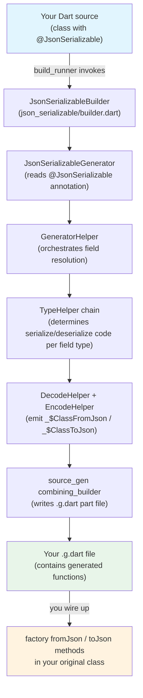
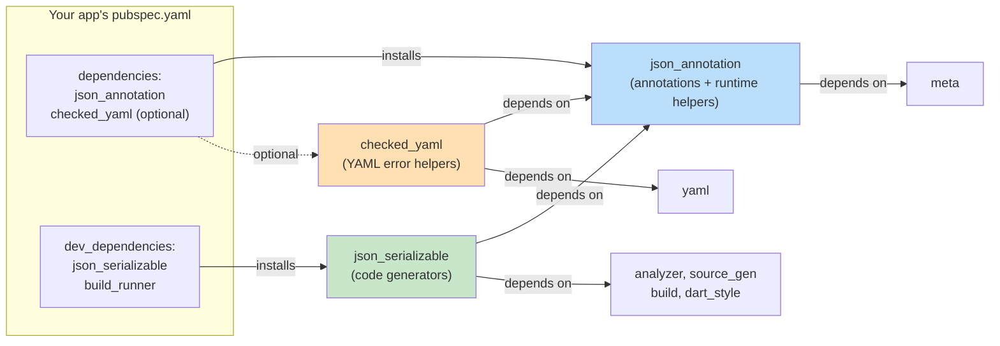

Welcome to the `json_serializable.dart` documentation. This page introduces the ecosystem of tools that **automatically generate Dart code for converting to and from JSON**. By annotating your Dart classes with simple metadata, you eliminate the need to write repetitive, error-prone serialization logic by hand. The generated code is type-safe, maintainable, and integrates seamlessly with the Dart build system.

## What Problem Does json_serializable Solve?

Every Dart application that consumes or produces JSON data faces the same challenge: converting between Dart objects and JSON-compatible maps. Manual implementation of `fromJson` and `toJson` methods is tedious and error-prone — a single typo in a field name can cause subtle runtime bugs.

`json_serializable` solves this through **compile-time code generation**. You annotate your classes with `@JsonSerializable()` and `@JsonKey()`, and a build-time code generator reads those annotations to produce the correct serialization code. The result is a `.g.dart` part file containing `_$YourClassFromJson` and `_$YourClassToJson` functions that you simply wire up with one-line factory constructors and methods.

The fundamental value proposition is **shift-left validation**: serialization bugs surface at build time rather than at runtime in production.

Sources: [README.md](README.md#L1-L41)

## The Three Packages

The ecosystem is organized into three packages, each with a distinct responsibility:

| Package | Role | When You Need It |
|---------|------|------------------|
| **`json_annotation`** | Defines the annotation classes (`@JsonSerializable`, `@JsonKey`, `@JsonConverter`, etc.) and runtime helpers | As a direct `dependencies:` entry — it has no transitive dependencies beyond `meta` |
| **`json_serializable`** | Contains the code generators that read annotations and emit `.g.dart` files | As a `dev_dependencies:` entry — only used during builds, never at runtime |
| **`checked_yaml`** | Wraps `package:yaml` decoding with source-location-aware error messages | As a `dependencies:` entry if you decode YAML configuration files |

The separation between `json_annotation` (runtime) and `json_serializable` (build-time) is critical: your production code never depends on the analyzer, source_gen, or any build infrastructure. The annotation package is intentionally lightweight.

Sources: [json_annotation/pubspec.yaml](json_annotation/pubspec.yaml#L1-L25), [json_serializable/pubspec.yaml](json_serializable/pubspec.yaml#L1-L47)

## Monorepo Structure

This repository is a Dart **workspace monorepo** — all packages live side by side and share a common SDK constraint and analysis options:

```
json_serializable.dart/
├── json_annotation/          # Annotation library (runtime dependency)
│   ├── lib/
│   │   ├── json_annotation.dart
│   │   └── src/              # JsonSerializable, JsonKey, JsonConverter, etc.
│   └── pubspec.yaml
├── json_serializable/        # Code generators (dev dependency)
│   ├── lib/
│   │   ├── builder.dart      # Builder entry point for build_runner
│   │   ├── json_serializable.dart
│   │   ├── type_helper.dart  # Public TypeHelper API
│   │   └── src/              # Generator, helpers, type helpers
│   ├── build.yaml            # Builder registration
│   ├── test/
│   └── tool/
├── checked_yaml/             # YAML decoding with error locations
│   ├── lib/
│   └── pubspec.yaml
├── example/                  # Working examples with generated output
│   ├── lib/
│   └── test/
├── shared_test/              # Shared test utilities (roundTripObject, etc.)
├── pubspec.yaml              # Workspace root
└── mono_repo.yaml            # CI orchestration
```

The workspace root `pubspec.yaml` declares all member packages under the `workspace:` key. This means a single `dart pub get` resolves all dependencies across every package.

Sources: [pubspec.yaml](pubspec.yaml#L1-L16)

## Architecture: How Annotations Become Code

The following diagram illustrates the end-to-end pipeline — from developer-authored annotations to the generated part file that runs at runtime:



The key insight is that **you write no serialization logic** — only annotations. The generator reads your class structure, resolves fields, determines types, and emits Dart code that is compiled into your application.

Sources: [json_serializable/lib/builder.dart](json_serializable/lib/builder.dart#L1-L50), [json_serializable/lib/src/json_serializable_generator.dart](json_serializable/lib/src/json_serializable_generator.dart#L1-L73)

## Core Annotations at a Glance

| Annotation | Target | Purpose |
|------------|--------|---------|
| `@JsonSerializable()` | Class | Marks a class for code generation; controls `fromJson`/`toJson` creation, field naming, null handling, and more |
| `@JsonKey()` | Field / Getter / Constructor parameter | Per-field overrides: custom JSON key name, default values, custom converters, null behavior, required validation |
| `@JsonConverter<T, S>()` | Class or Field | Attaches a reusable `JsonConverter` for custom type serialization |
| `@JsonEnum()` | Enum | Configures enum serialization strategy (field rename, value field) |
| `@JsonValue()` | Enum value | Overrides the serialized value for a specific enum entry |
| `@JsonLiteral()` | Getter | Generates a constant from a JSON file on disk |

The `@JsonSerializable` annotation alone has over **25 configuration parameters** — from `checked` mode to `genericArgumentFactories` to `createJsonSchema`. These are covered in depth in [JsonSerializable Class Annotation Reference](4-jsonserializable-class-annotation-reference).

Sources: [json_annotation/lib/src/json_serializable.dart](json_annotation/lib/src/json_serializable.dart#L28-L340), [json_annotation/lib/src/json_key.dart](json_annotation/lib/src/json_key.dart#L1-L185), [json_annotation/lib/src/json_converter.dart](json_annotation/lib/src/json_converter.dart#L1-L51), [json_annotation/lib/src/json_enum.dart](json_annotation/lib/src/json_enum.dart#L1-L46), [json_annotation/lib/src/json_value.dart](json_annotation/lib/src/json_value.dart#L1-L14), [json_annotation/lib/src/json_literal.dart](json_annotation/lib/src/json_literal.dart#L1-L32)

## Minimal Working Example

Here is the simplest possible usage to ground the concepts:

```dart
import 'package:json_annotation/json_annotation.dart';

part 'user.g.dart';

@JsonSerializable()
class User {
  final String name;
  final int age;

  User({required this.name, required this.age});

  factory User.fromJson(Map<String, dynamic> json) => _$UserFromJson(json);

  Map<String, dynamic> toJson() => _$UserToJson(this);
}
```

Running `dart run build_runner build` produces `user.g.dart` containing:

```dart
User _$UserFromJson(Map<String, dynamic> json) => User(
      name: json['name'] as String,
      age: (json['age'] as num).toInt(),
    );

Map<String, dynamic> _$UserToJson(User instance) => <String, dynamic>{
      'name': instance.name,
      'age': instance.age,
    };
```

The generated code handles type casting, nullable types, nested objects, lists, maps, and all the edge cases that would be tedious to write manually. A more complete example with nested types, custom keys, and multiple classes can be found in the example directory:

Sources: [example/lib/example.dart](example/lib/example.dart#L1-L89), [example/lib/example.g.dart](example/lib/example.g.dart#L1-L89)

## Extension and Customization Points

The system is designed to be extensible at multiple levels:

| Extension Mechanism | What It Does | Complexity |
|---------------------|--------------|------------|
| **`@JsonKey` parameters** | Per-field customization without writing code | Beginner |
| **`@JsonConverter` implementations** | Reusable type conversion for custom types | Intermediate |
| **`TypeHelper` subclasses** | Register new type handling in the generator pipeline | Advanced |
| **`build.yaml` configuration** | Package-level default settings via builder options | Intermediate |
| **`genericArgumentFactories`** | Support for generic classes with type parameters | Intermediate |

The **TypeHelper** system is particularly powerful — it is an open extension point that allows third-party packages to teach the generator how to handle entirely new types. Built-in helpers already cover `DateTime`, `Duration`, `BigInt`, `Uri`, enums, iterables, maps, and records.

Sources: [json_serializable/lib/type_helper.dart](json_serializable/lib/type_helper.dart#L1-L21), [json_serializable/lib/src/type_helper.dart](json_serializable/lib/src/type_helper.dart#L1-L87)

## Package Dependency Map

Understanding which package goes where in your `pubspec.yaml` is essential:



**Rule of thumb**: `json_annotation` is a runtime dependency because your generated `.g.dart` code imports it. `json_serializable` is a dev dependency because it only runs during `build_runner` execution. `checked_yaml` is optional — only needed if you decode YAML files.

Sources: [json_annotation/pubspec.yaml](json_annotation/pubspec.yaml#L1-L25), [json_serializable/pubspec.yaml](json_serializable/pubspec.yaml#L1-L47)

## What This Documentation Covers

This wiki is organized into two sections following a progressive learning path:

**Get Started** — foundational knowledge:
1. **Overview** (this page) — what the ecosystem is and how it fits together
2. [Quick Start](2-quick-start) — step-by-step setup and first generated file
3. [Monorepo Package Layout](3-monorepo-package-layout) — detailed structure of each package

**Deep Dive** — comprehensive reference for every feature, from annotations to internals:
- Annotation references: [JsonSerializable](4-jsonserializable-class-annotation-reference), [JsonKey](5-jsonkey-field-annotation-reference), [JsonEnum/JsonValue/JsonLiteral](6-jsonenum-jsonvalue-and-jsonliteral-annotations)
- Serialization mechanics: [JsonConverter](7-jsonconverter-for-custom-type-serialization), [TypeHelper system](9-the-typehelper-extension-system), [Enum serialization](15-enum-serialization-and-enumhelper)
- Generator internals: [Pipeline](8-generator-pipeline-from-annotations-to-generated-code), [DecodeHelper/EncodeHelper](10-decodehelper-and-encodehelper-fromjson-tojson-generation), [GeneratorHelper orchestration](11-generatorhelper-orchestration-and-field-resolution)
- Advanced topics: [Generic classes](19-generic-classes-with-genericargumentfactories), [Checked deserialization](20-checked-deserialization-for-safer-fromjson), [Custom TypeHelpers](21-writing-a-custom-typehelper)

**Recommended reading order for beginners**: Start with [Quick Start](2-quick-start) after this page, then read [JsonSerializable Class Annotation Reference](4-jsonserializable-class-annotation-reference) and [JsonKey Field Annotation Reference](5-jsonkey-field-annotation-reference) to understand the configuration surface. Explore the generator internals only when you need to debug or extend the system.