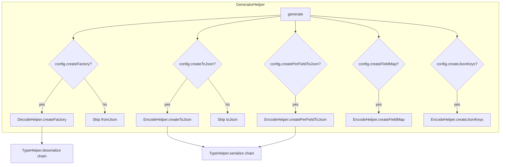
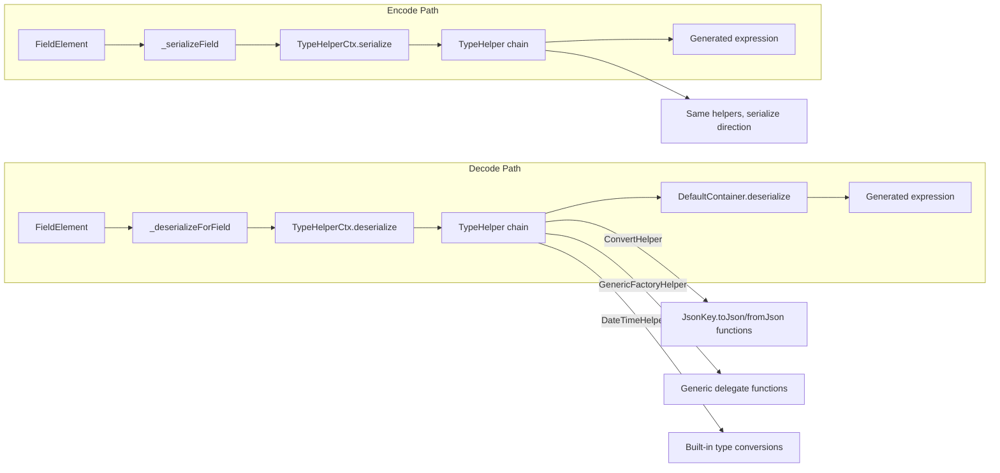

The decode and encode helpers are the core engines that transform annotated Dart classes into JSON-compatible factory constructors and serialization methods. These two `mixin` classes—`DecodeHelper` and `EncodeHelper`—are combined inside [`GeneratorHelper`](json_serializable/lib/src/generator_helper.dart#L18-L19) to produce the top-level `_$ClassNameFromJson` and `_$ClassNameToJson` functions that appear in every generated `.g.dart` file.

Together, they embody the central contract of `json_serializable`: given a class annotated with `@JsonSerializable`, generate static functions that convert between `Map<String, dynamic>` and fully-typed Dart objects, honoring every `@JsonKey` parameter, converter, default value, and generic type argument along the way.

## Architecture Overview

Both helpers implement the [`HelperCore`](json_serializable/lib/src/helper_core.dart#L19-L57) abstract contract, which gives them access to the target class element, the merged [`ClassConfig`](json_serializable/lib/src/helper_core.dart#L21), and the full set of registered [`TypeHelper`](json_serializable/lib/src/type_helper.dart#L37-L86) instances. The `GeneratorHelper` class mixes in both helpers and orchestrates the generation pipeline:



Sources: [generator_helper.dart](json_serializable/lib/src/generator_helper.dart#L40-L149), [json_serializable_generator.dart](json_serializable/lib/src/json_serializable_generator.dart#L57-L71)

## DecodeHelper: Generating `fromJson` Factories

`DecodeHelper` is responsible for generating the static factory function `_$ClassNameFromJson` that converts a `Map<String, dynamic>` (or `Map` when `anyMap: true`) into a fully-constructed class instance. Its primary entry point is the [`createFactory`](json_serializable/lib/src/decode_helper.dart#L25-L171) method.

### Factory Signature Generation

The factory signature is constructed in the opening lines of `createFactory`. It always returns the target class type and accepts the JSON map as its first argument. When `genericArgumentFactories` is enabled and the class has type parameters, additional function parameters are appended—one per type argument—for delegate serialization:

```dart
Person _$PersonFromJson<T extends num>(
  Map<String, dynamic> json,
  T Function(Object? json) fromJsonT,
) => ...
```

The map type is either `Map<String, dynamic>` (default) or `Map` (when `anyMap: true`), controlled by `config.anyMap` at [line 32](json_serializable/lib/src/decode_helper.dart#L32-L33).

Sources: [decode_helper.dart](json_serializable/lib/src/decode_helper.dart#L30-L52)

### Constructor Invocation Logic

The heart of `DecodeHelper` is the private [`_writeConstructorInvocation`](json_serializable/lib/src/decode_helper.dart#L276-L361) function. This function performs a sophisticated analysis of the target class's constructor:

1. **Parameter Classification** — It iterates over the chosen constructor's `formalParameters`, splitting them into positional and named arguments. Only parameters whose names appear in the `availableConstructorParameters` set (derived from fields accessible for JSON) are included; required parameters missing from this set trigger an [`InvalidGenerationSourceError`](json_serializable/lib/src/decode_helper.dart#L296-L306).

2. **Constructor Arguments** — For each included parameter, the corresponding field is deserialized using the `deserializeFun` callback and emitted as a positional or named argument in the constructor call.

3. **Fields Set After Construction** — Fields that are not served by the constructor (e.g., non-final fields, setter-only properties) are identified in `remainingFieldsForInvocationBody` and assigned via cascade notation after the constructor returns.

This two-phase approach—construct then assign—allows `json_serializable` to handle classes with immutable constructor arguments alongside mutable properties in a single coherent expression:

```dart
// Constructor args: firstName, lastName, house
// Fields set after: middleName, order, customOrders
Person _$PersonFromJson(Map<String, dynamic> json) =>
    Person(
      json['firstName'] as String,
      json['lastName'] as String,
      $enumDecode(_$CategoryEnumMap, json[r'$house']),
      middleName: json['middleName'] as String?,
    )
    ..order = json['order'] == null
        ? null
        : Order.fromJson(json['order'] as Map<String, dynamic>);
```

Sources: [decode_helper.dart](json_serializable/lib/src/decode_helper.dart#L276-L361), [json_test_example.g.dart](json_serializable/test/integration/json_test_example.g.dart#L11-L37)

### Field Deserialization

The [`_deserializeForField`](json_serializable/lib/src/decode_helper.dart#L210-L263) method handles individual field deserialization. It resolves the target type (from the constructor parameter type or the field type), retrieves the field's [`KeyConfig`](json_serializable/lib/src/json_key_utils.dart), and delegates to the [`TypeHelperCtx.deserialize`](json_serializable/lib/src/type_helper_ctx.dart#L59-L76) method which walks the type helper chain until a match is found.

Two deserialization modes exist depending on `config.checked`:

| Mode | Expression Pattern | Error Handling |
|------|-------------------|----------------|
| **Unchecked** (default) | `json[$jsonKeyName]` or `$readValueFunc(json, $jsonKeyName)` | Runtime `TypeError` / `CastError` |
| **Checked** | `$checkedConvert($jsonKeyName, (v) => ...)` | Source-aware errors with class name, field name, and key |

When `readValueFunctionName` is set via `@JsonKey(readValue: ...)`, the raw expression is passed through that function instead of direct map access. This allows custom pre-processing of JSON values before type coercion.

Sources: [decode_helper.dart](json_serializable/lib/src/decode_helper.dart#L210-L263)

### Key Validation: `_checkKeys`

Before deserialization begins, the [`_checkKeys`](json_serializable/lib/src/decode_helper.dart#L173-L206) method generates `$checkKeys(...)` calls that enforce JSON map constraints. These constraints are driven by `@JsonKey` parameters:

| Parameter | Generated Check | Effect |
|-----------|----------------|--------|
| `disallowUnrecognizedKeys: true` | `allowedKeys: [...]` | Rejects maps with keys not matching any field |
| `required: true` (on fields) | `requiredKeys: [...]` | Rejects maps missing required keys |
| `disallowNullValue: true` (on fields) | `disallowNullValues: [...]` | Rejects maps where listed keys have `null` values |

These checks are only emitted inside the `$checkKeys` function call in **checked mode**; in unchecked mode, they appear as standalone pre-validation statements at the top of the factory body.

Sources: [decode_helper.dart](json_serializable/lib/src/decode_helper.dart#L173-L206)

### Checked vs. Unchecked: Complete Factory Output

The full factory output differs significantly between the two modes. In checked mode, the entire constructor invocation and field assignments are wrapped inside `$checkedCreate`:

```dart
// Checked mode structure
_$PersonFromJson(Map<String, dynamic> json) =>
  $checkedCreate(
    'Person',
    json,
    ($checkedConvert) {
      $checkKeys(json, requiredKeys: const ['firstName', 'lastName']);
      final val = Person(
        $checkedConvert('firstName', (v) => v as String),
        $checkedConvert('lastName', (v) => v as String),
      );
      $checkedConvert('middleName', (v) => val.middleName = v as String?);
      return val;
    },
    fieldKeyMap: const {'middleName': 'middleName'},
  );
```

In unchecked mode, the code is a straightforward sequential expression with no wrapper:

```dart
// Unchecked mode structure
_$PersonFromJson(Map<String, dynamic> json) {
  $checkKeys(json, requiredKeys: const ['firstName', 'lastName']);
  return Person(
    json['firstName'] as String,
    json['lastName'] as String,
  )..middleName = json['middleName'] as String?;
}
```

Sources: [decode_helper.dart](json_serializable/lib/src/decode_helper.dart#L89-L155), [decode_helper.dart](json_serializable/lib/src/decode_helper.dart#L157-L168)

## EncodeHelper: Generating `toJson` Methods

`EncodeHelper` is responsible for generating the serialization side—the static function `_$ClassNameToJson` that converts a class instance into a `Map<String, dynamic>`. It also provides supplementary generation methods for field maps, JSON key constants, and per-field serialization functions.

### The `createToJson` Method

The [`createToJson`](json_serializable/lib/src/encoder_helper.dart#L89-L122) method generates the primary serialization function. Its output is an expression-bodied function that returns a `Map<String, dynamic>` literal:

```dart
Map<String, dynamic> _$PersonToJson(Person instance) => <String, dynamic>{
  'firstName': instance.firstName,
  'lastName': instance.lastName,
  'middleName': instance.middleName,
  'dateOfBirth': instance.dateOfBirth?.toIso8601String(),
};
```

Each field entry is produced by iterating over the `accessibleFields` set. For each field, two expressions are computed:

1. **Key expression** — The JSON key name, obtained via `safeNameAccess(field)` which resolves the `@JsonKey(name: ...)` annotation and escapes the string for use as a Dart map literal key.

2. **Value expression** — The serialized field value, computed by [`_serializeField`](json_serializable/lib/src/encoder_helper.dart#L138-L147) which delegates to `TypeHelperCtx.serialize`.

A critical detail is null-safety handling. The [`_canWriteJsonWithoutNullCheck`](json_serializable/lib/src/encoder_helper.dart#L151-L183) method determines whether a field can be written as a plain value or requires the `?` (null-aware) prefix. The `?` prefix prevents `null` values from being written to JSON for nullable fields, unless `includeIfNull: true` is set. This check considers:

- The `includeIfNull` `@JsonKey` parameter
- The return type of any custom `toJson` converter
- Whether a `JsonConverter` produces nullable output
- Whether an enum's encode map contains a `null` value
- The field's own nullability

Sources: [encoder_helper.dart](json_serializable/lib/src/encoder_helper.dart#L89-L122), [encoder_helper.dart](json_serializable/lib/src/encoder_helper.dart#L151-L183)

### Null-Aware Serialization Pattern

The null-aware serialization produces the `?` prefix before value expressions in the map literal. This is a Dart 3 feature that allows conditional inclusion of map entries:

```dart
// Field with includeIfNull: false (default for nullable)
'dateOfBirth': ?instance.dateOfBirth?.toIso8601String(),

// Field with includeIfNull: true
'nullableField': instance.nullableField,

// Field with custom converter returning non-nullable
'convertedField': const MyConverter().toJson(instance.convertedField),
```

Sources: [encoder_helper.dart](json_serializable/lib/src/encoder_helper.dart#L113-L116), [json_test_example.g.dart](json_serializable/test/integration/json_test_example.g.dart#L39-L53)

### Per-Field Serialization: `createPerFieldToJson`

When `config.createPerFieldToJson` is true, [`EncodeHelper`](json_serializable/lib/src/encoder_helper.dart#L18-L44) generates an abstract class containing a static method for each accessible field. These methods accept a single field value and return its serialized `Object?` representation. This enables downstream code generators or reflection-like patterns to serialize individual fields on demand:

```dart
abstract class _$PersonPerFieldToJson {
  static Object? firstName(Person instance) => instance.firstName;
  static Object? lastName(Person instance) => instance.lastName;
  static Object? dateOfBirth(Person instance) =>
      instance.dateOfBirth?.toIso8601String();
}
```

Each per-field method also handles `genericArgumentFactories` if applicable, adding the same delegate function parameters as the main `toJson`.

Sources: [encoder_helper.dart](json_serializable/lib/src/encoder_helper.dart#L18-L44)

### Field Metadata: `createFieldMap` and `createJsonKeys`

Two additional metadata generation methods exist for interop with other code generators:

**`createFieldMap`** produces a `Map<String, String>` constant mapping Dart field names to their JSON key names:

```dart
const _$PersonFieldMap = <String, String>{
  'firstName': 'firstName',
  'lastName': 'lastName',
  'dateOfBirth': 'dateOfBirth',
};
```

**`createJsonKeys`** produces a class with `static const String` fields, one per accessible field:

```dart
abstract final class _$PersonJsonKeys {
  static const String firstName = 'firstName';
  static const String lastName = 'lastName';
  static const String dateOfBirth = 'dateOfBirth';
}
```

Both are gated behind `config.createFieldMap` and `config.createJsonKeys` respectively.

Sources: [encoder_helper.dart](json_serializable/lib/src/encoder_helper.dart#L48-L65), [encoder_helper.dart](json_serializable/lib/src/encoder_helper.dart#L69-L87)

## The TypeHelper Chain: Serialization and Deserialization Delegate

Neither `DecodeHelper` nor `EncodeHelper` directly contains type-specific serialization logic. Instead, both delegate to the [`TypeHelper`](json_serializable/lib/src/type_helper.dart#L37-L86) extension system through [`TypeHelperCtx`](json_serializable/lib/src/type_helper_ctx.dart#L23-L91). The context walks through the registered type helpers in priority order and uses the first one that returns a non-null result.

The following diagram shows how a single field flows through the decode/encode pipeline:



The type helper chain is assembled from two sources:

1. **Built-in helpers** registered in [`Settings.defaultHelpers`](json_serializable/lib/src/settings.dart): `BigIntHelper`, `DateTimeHelper`, `DurationHelper`, `JsonHelper`, `UriHelper`
2. **User-provided helpers** via `JsonSerializableGenerator(typeHelpers: [...])` or `JsonSerializableGenerator.withDefaultHelpers([...])`
3. **Configured helpers**: `ConvertHelper` (for `@JsonKey` toJson/fromJson), `GenericFactoryHelper` (for generic type parameters), `EnumHelper`, `IterableHelper`, `MapHelper`, `RecordHelper`, `JsonConverterHelper`

Sources: [type_helper_ctx.dart](json_serializable/lib/src/type_helper_ctx.dart#L52-L90), [type_helper.dart](json_serializable/lib/src/type_helper.dart#L37-L86)

## Generic Argument Factories

When a generic class is annotated with `@JsonSerializable(genericArgumentFactories: true)`, both helpers emit additional function parameters for each type parameter. The [`GenericFactoryHelper`](json_serializable/lib/src/type_helpers/generic_factory_helper.dart#L12-L56) handles the serialization/deserialization of type-parameterized fields by calling these delegate functions.

The naming convention uses the `fromJsonForType`/`toJsonForType` functions from [`generic_factory_helper`](json_serializable/lib/src/type_helpers/generic_factory_helper.dart#L80-L88):

| Type Parameter | fromJson Function | toJson Function |
|---------------|-------------------|-----------------|
| `T` | `fromJsonT` | `toJsonT` |
| `K` | `fromJsonK` | `toJsonK` |

For nullable type parameters, the helper generates utility functions `_$nullableGenericFromJson` and `_$nullableGenericToJson` that safely handle `null` inputs:

```dart
T? _$nullableGenericFromJson<T>(
  Object? input,
  T Function(Object? json) fromJson,
) => input == null ? null : fromJson(input);
```

Sources: [generic_factory_helper.dart](json_serializable/lib/src/type_helpers/generic_factory_helper.dart#L12-L56), [generic_factory_helper.dart](json_serializable/lib/src/type_helpers/generic_factory_helper.dart#L58-L88)

## Relationship to Other Components

The following table summarizes the responsibilities of each helper class and how they interconnect:

| Class | Role | Inputs | Outputs |
|-------|------|--------|---------|
| [`DecodeHelper`](json_serializable/lib/src/decode_helper.dart#L24) | Factory generation | Class element, accessible fields, config | `_$ClassNameFromJson` function |
| [`EncodeHelper`](json_serializable/lib/src/encoder_helper.dart#L15) | Serialization generation | Accessible field set, config | `_$ClassNameToJson` function, field maps, per-field helpers |
| [`GeneratorHelper`](json_serializable/lib/src/generator_helper.dart#L18-L19) | Orchestration | Both helpers mixed in | Complete generated output |
| [`TypeHelperCtx`](json_serializable/lib/src/type_helper_ctx.dart#L23) | Type dispatch | Field element, type helpers | Serialized/deserialized expression |
| [`HelperCore`](json_serializable/lib/src/helper_core.dart#L19) | Shared contract | Class element, config | Common utilities (name access, generic args) |

Sources: [decode_helper.dart](json_serializable/lib/src/decode_helper.dart#L24), [encoder_helper.dart](json_serializable/lib/src/encoder_helper.dart#L15), [generator_helper.dart](json_serializable/lib/src/generator_helper.dart#L18-L19), [helper_core.dart](json_serializable/lib/src/helper_core.dart#L19-L57)

## Generated Code Patterns

The following table catalogs the distinct code patterns that `DecodeHelper` and `EncodeHelper` produce, with cross-references to real generated output:

| Pattern | Helper | Example | Source |
|---------|--------|---------|--------|
| Simple positional constructor args | Decode | `Person(json['firstName'] as String, ...)` | [json_test_example.g.dart#L12-L20](json_serializable/test/integration/json_test_example.g.dart#L12-L20) |
| Named constructor args | Decode | `middleName: json['middleName'] as String?` | [json_test_example.g.dart#L16](json_serializable/test/integration/json_test_example.g.dart#L16) |
| Cascade field assignment | Decode | `..order = json['order'] == null ? null : ...` | [json_test_example.g.dart#L21-L23](json_serializable/test/integration/json_test_example.g.dart#L21-L23) |
| Enum decoding | Decode | `$enumDecode(_$CategoryEnumMap, json[r'$house'])` | [json_test_example.g.dart#L15](json_serializable/test/integration/json_test_example.g.dart#L15) |
| JsonConverter delegation | Decode | `const DateTimeConverter().fromJson(json['date'] as String)` | [converter_examples.g.dart#L54-L57](json_serializable/test/integration/converter_examples.g.dart#L54-L57) |
| Nullable-aware map entry | Encode | `'dateOfBirth': ?instance.dateOfBirth?.toIso8601String()` | [json_test_example.g.dart#L43](json_serializable/test/integration/json_test_example.g.dart#L43) |
| Enum encoding | Encode | `r'$house': _$CategoryEnumMap[instance.house]!` | [json_test_example.g.dart#L44](json_serializable/test/integration/json_test_example.g.dart#L44) |
| Map serialization | Encode | `instance.houseMap?.map((k, e) => MapEntry(k, ...))` | [json_test_example.g.dart#L47-L49](json_serializable/test/integration/json_test_example.g.dart#L47-L49) |
| Checked factory wrapper | Decode | `$checkedCreate('Person', json, ($checkedConvert) {...})` | Controlled by `config.checked` |

## Next Steps

To understand the full generation pipeline from annotation to output, see [GeneratorHelper Orchestration and Field Resolution](11-generatorhelper-orchestration-and-field-resolution). For details on how the TypeHelper system dispatches to individual type handlers, see [The TypeHelper Extension System](9-the-typehelper-extension-system). To understand the JsonConverter integration used by both helpers, see [JsonConverterHelper and Generic Factory Support](16-jsonconverterhelper-and-generic-factory-support).