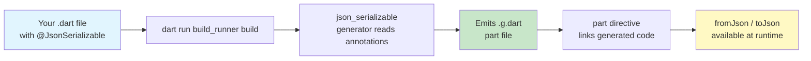
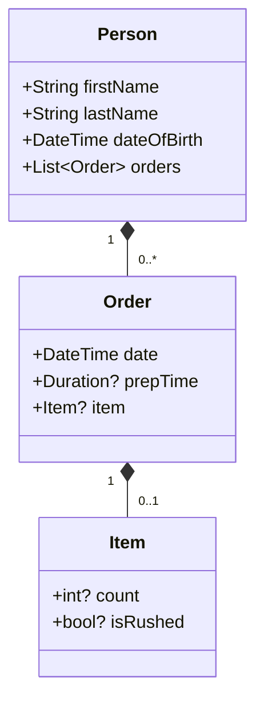

This guide walks you through adding JSON serialization to your Dart project using `json_serializable` in under five minutes. You will annotate a class, run the code generator, and convert Dart objects to and from JSON with zero hand-written boilerplate.

## What is json_serializable?

`json_serializable` is a Dart **code-generation** package. Instead of writing `fromJson` and `toJson` methods by hand, you add lightweight annotations to your classes and a build-time generator produces the conversion code for you into a companion `.g.dart` file.

The system is split across two packages:

| Package | Role | Dependency type |
|---|---|---|
| `json_annotation` | Defines the annotation classes (`@JsonSerializable`, `@JsonKey`, etc.) with zero transitive dependencies | `dependencies` |
| `json_serializable` | Contains the build-time generator that reads annotations and emits Dart code | `dev_dependencies` |

Because `json_annotation` is a runtime dependency with no dependencies of its own, it stays lightweight in production. The heavier generator lives only in your dev toolchain.

Sources: [README.md](README.md#L7-L22)

## Architecture Overview

The following diagram shows the end-to-end data flow from your annotated source file to the usable `fromJson`/`toJson` methods:



## Step 1 — Add Dependencies

Open your project's `pubspec.yaml` and add the two required packages. The annotation goes under `dependencies` and the generator plus `build_runner` go under `dev_dependencies`:

```yaml
dependencies:
  json_annotation: ^4.9.0

dev_dependencies:
  build_runner: ^2.10.5
  json_serializable: ^6.10.0
```

Then fetch them:

```console
$ dart pub get
```

If you are using Flutter, replace `dart` with `flutter`.

Sources: [example/pubspec.yaml](example/pubspec.yaml#L11-L19)

## Step 2 — Annotate Your Class

Create a Dart file (for example `lib/person.dart`) and define your class. Three things are required:

1. **Import** `package:json_annotation/json_annotation.dart`.
2. **Declare a part file** with `part 'person.g.dart';` — the generator will write conversion code here.
3. **Annotate** the class with `@JsonSerializable()`.
4. **Wire up** the generated functions from a `fromJson` factory constructor and a `toJson` method.

```dart
import 'package:json_annotation/json_annotation.dart';

part 'person.g.dart';

@JsonSerializable()
class Person {
  final String firstName;
  final String lastName;
  final DateTime? dateOfBirth;

  Person({required this.firstName, required this.lastName, this.dateOfBirth});

  /// Connect the generated [_$PersonFromJson] function.
  factory Person.fromJson(Map<String, dynamic> json) =>
      _$PersonFromJson(json);

  /// Connect the generated [_$PersonToJson] function.
  Map<String, dynamic> toJson() => _$PersonToJson(this);
}
```

> **Why `part`?** The generator places the conversion logic in a separate `.g.dart` file. The `part` directive stitches it back into your original library so the private `_$PersonFromJson` and `_$PersonToJson` identifiers are accessible.

Sources: [json_serializable/example/example.dart](json_serializable/example/example.dart#L1-L27)

## Step 3 — Run the Code Generator

With the annotations in place, invoke the build runner:

```console
$ dart run build_runner build
```

The command scans your package for `@JsonSerializable` annotations and emits a `.g.dart` file next to each annotated source file. For the `Person` example above, the output is `person.g.dart`:

```dart
// GENERATED CODE - DO NOT MODIFY BY HAND

part of 'person.dart';

Person _$PersonFromJson(Map<String, dynamic> json) => Person(
      firstName: json['firstName'] as String,
      lastName: json['lastName'] as String,
      dateOfBirth: json['dateOfBirth'] == null
          ? null
          : DateTime.parse(json['dateOfBirth'] as String),
    );

Map<String, dynamic> _$PersonToJson(Person instance) => <String, dynamic>{
      'firstName': instance.firstName,
      'lastName': instance.lastName,
      'dateOfBirth': instance.dateOfBirth?.toIso8601String(),
    };
```

During active development you may prefer **watch mode** so the generator re-runs on every file save:

```console
$ dart run build_runner watch
```

Sources: [json_serializable/example/example.g.dart](json_serializable/example/example.g.dart#L1-L35)

## Step 4 — Use Your Serializable Class

Now you can convert objects to JSON and back with no extra work:

```dart
import 'dart:convert';
import 'package:example/person.dart';

void main() {
  // Create an object
  final person = Person(
    firstName: 'Inigo',
    lastName: 'Montoya',
    dateOfBirth: DateTime(1560, 5, 5),
  );

  // Encode to JSON
  final json = jsonEncode(person);
  print(json);
  // {"firstName":"Inigo","lastName":"Montoya","dateOfBirth":"1560-05-05T00:00:00.000"}

  // Decode from JSON
  final decoded = Person.fromJson(
    jsonDecode(json) as Map<String, dynamic>,
  );
  print(decoded.firstName); // Inigo
}
```

Sources: [example/test/example_test.dart](example/test/example_test.dart#L12-L28)

## Customizing Field Names with `@JsonKey`

Often the JSON key for a field differs from the Dart field name. The `@JsonKey` annotation lets you specify a custom mapping per field. Other common options include `defaultValue`, `includeIfNull`, and `required`.

```dart
@JsonSerializable()
class Order {
  @JsonKey(name: 'date-of-birth')
  final DateTime dateOfBirth;

  @JsonKey(includeIfNull: false)
  String? note;

  Order(this.dateOfBirth, {this.note});

  factory Order.fromJson(Map<String, dynamic> json) => _$OrderFromJson(json);
  Map<String, dynamic> toJson() => _$OrderToJson(this);
}
```

| `@JsonKey` parameter | Purpose | Default |
|---|---|---|
| `name` | Override the JSON key for this field | Field name unchanged |
| `defaultValue` | Value used when the key is absent or `null` | None |
| `required` | Throw if the key is missing from the JSON map | `false` |
| `includeIfNull` | Include the field even when the value is `null` | Inherits from class-level setting |
| `fromJson` / `toJson` | Custom encode/decode functions for this field | None |

Sources: [example/lib/example.dart](example/lib/example.dart#L16-L17), [json_annotation/lib/src/json_key.dart](json_annotation/lib/src/json_key.dart#L1-L185)

## Nesting Objects

When a class contains fields of other annotated classes, the generator handles them automatically — no converter functions are needed. In the repository's primary example, `Person` contains a `List<Order>`, and `Order` contains an optional `Item`:



Because `Order.fromJson` and `Item.fromJson` exist, the generated `_$PersonFromJson` simply delegates to them — the entire object graph is decoded in a single call.

Sources: [example/lib/example.dart](example/lib/example.dart#L28-L39), [example/lib/example.g.dart](example/lib/example.g.dart#L11-L24)

## Working with Enums

Enums get their own annotation, `@JsonEnum`, and individual values can be customized with `@JsonValue`:

```dart
@JsonEnum(fieldRename: FieldRename.kebab)
enum OrderStatus {
  pending,
  @JsonValue('in-progress')
  inProgress,
  shipped,
  delivered,
}
```

| Annotation | Target | Key properties |
|---|---|---|
| `@JsonEnum` | `enum` declarations | `fieldRename` — bulk rename strategy (`none`, `kebab`, `snake`, `pascal`, `screamingSnake`); `valueField` — use an enhanced enum field as the serialized value |
| `@JsonValue` | Individual `enum` values | `value` — the exact `String` or `int` to store in JSON |

Sources: [json_annotation/lib/src/json_enum.dart](json_annotation/lib/src/json_enum.dart#L1-L46), [json_annotation/lib/src/json_value.dart](json_annotation/lib/src/json_value.dart#L1-L14)

## Class-Level Defaults

The `@JsonSerializable` annotation accepts many named parameters that serve as defaults for every field in the class. A few of the most commonly used ones:

| Parameter | Effect | Default |
|---|---|---|
| `anyMap` | Accept `Map` instead of only `Map<String, dynamic>` (useful with YAML) | `false` |
| `checked` | Wrap deserialization errors in `CheckedFromJsonException` for safer error handling | `false` |
| `fieldRename` | Bulk rename strategy applied to all fields (`none`, `kebab`, `snake`, `pascal`, `screamingSnake`) | `FieldRename.none` |
| `includeIfNull` | Include fields with `null` values in the JSON output | `true` |
| `explicitToJson` | Call `.toJson()` on nested objects explicitly | `false` |
| `disallowUnrecognizedKeys` | Throw on unexpected keys during deserialization | `false` |
| `createJsonSchema` | Generate a JSON Schema constant alongside the class | `false` |

Values set on individual `@JsonKey` annotations always override the class-level defaults.

Sources: [json_annotation/lib/src/json_serializable.dart](json_annotation/lib/src/json_serializable.dart#L1-L200)

## Common Pitfalls and Tips

1. **Don't forget the `part` directive.** Without `part 'your_file.g.dart';` the generated code is unreachable and you will see a compile error about the missing `_$YourClassFromJson` function.
2. **Run the generator after every annotation change.** The `.g.dart` file is not updated automatically — either run `build_runner build` manually or use `build_runner watch`.
3. **Check the generated file into source control** (or add `*.g.dart` to `.gitignore` and generate during CI). The repository's convention is to commit generated files so that consumers can use the package without running the generator themselves.
4. **Every `fromJson` factory must call `_$YourClassFromJson`.** This is the glue between your hand-written class and the generated logic. Without it, deserialization silently falls back to Dart's default behavior (which does nothing useful).

## Next Steps

Now that you have a working serializable class, you can explore the deeper capabilities of the package:

- **[Overview](1-overview)** — understand the full scope of the json_serializable ecosystem.
- **[Monorepo Package Layout](3-monorepo-package-layout)** — learn how the repository is organized across multiple packages.
- **[JsonSerializable Class Annotation Reference](4-jsonserializable-class-annotation-reference)** — exhaustive reference for every `@JsonSerializable` parameter.
- **[JsonKey Field Annotation Reference](5-jsonkey-field-annotation-reference)** — exhaustive reference for every `@JsonKey` parameter.
- **[JsonConverter for Custom Type Serialization](7-jsonconverter-for-custom-type-serialization)** — implement `JsonConverter<T, S>` to handle types not supported out of the box.