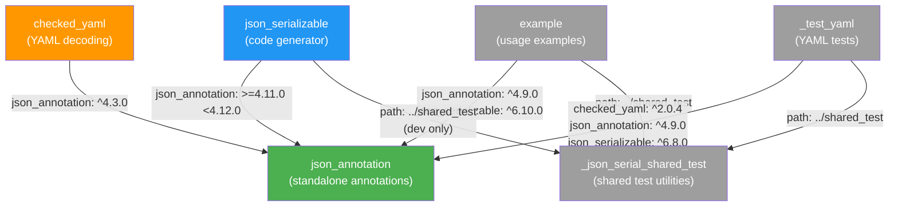

The `json_serializable.dart` repository is organized as a **Dart workspace monorepo**, containing multiple interrelated packages in a single Git repository. Understanding this layout is essential before diving into individual packages, because many files, tests, and configurations are shared across the codebase through workspace-level tooling. This page explains the purpose of each package, how they relate to each other, and how the monorepo infrastructure keeps everything in sync.

## Workspace Structure Overview

The monorepo root at `pubspec.yaml` declares a **Dart workspace** — a feature available since Dart SDK 3.9.0 that lets multiple packages in the same repository share a single resolution context. Each package's `pubspec.yaml` includes `resolution: workspace`, which tells the Dart toolchain to resolve dependencies across the entire workspace as a unit rather than independently.

Sources: [pubspec.yaml](pubspec.yaml#L9-L16)

The workspace contains **six packages**, each in its own subdirectory:

| Package | Directory | Published? | Purpose |
|---|---|---|---|
| `json_annotation` | `json_annotation/` | ✅ Yes | Annotation classes for marking Dart classes for JSON serialization |
| `json_serializable` | `json_serializable/` | ✅ Yes | The `build_runner` code generator that reads annotations and emits `fromJson`/`toJson` |
| `checked_yaml` | `checked_yaml/` | ✅ Yes | YAML decoding with source-location-aware error messages |
| `example` | `example/` | ❌ No | Runnable examples demonstrating common usage patterns |
| `_json_serial_shared_test` | `shared_test/` | ❌ No | Shared test utilities used by other packages (prefixed with `_` to indicate internal use) |
| `_test_yaml` | `_test_yaml/` | ❌ No | Internal package for testing YAML-related functionality |

Sources: [pubspec.yaml](pubspec.yaml#L9-L16)

## Package Dependency Graph

Understanding how the packages depend on each other is critical. The arrows below represent a "depends on" relationship:



The two foundational packages — **`json_annotation`** and **`json_serializable`** — have a strict one-way dependency: the generator depends on the annotations, but the annotations have zero dependency on the generator. This separation is deliberate: end users only need to import `json_annotation` as a regular (non-dev) dependency, keeping the heavy code-generation tooling out of production code.

Sources: [json_serializable/pubspec.yaml](json_serializable/pubspec.yaml#L26), [json_annotation/pubspec.yaml](json_annotation/pubspec.yaml#L18-L19), [checked_yaml/pubspec.yaml](checked_yaml/pubspec.yaml#L20-L23)

## Core Packages in Detail

### `json_annotation` — The Annotation Library

This is the **runtime dependency** that end users add to their projects. It provides the annotation classes (`@JsonSerializable`, `@JsonKey`, `@JsonEnum`, `@JsonValue`, `@JsonConverter`, `@JsonLiteral`) and a few helper functions that generated code calls at runtime (such as `$enumDecode` and checked-deserialization helpers).

Because it carries no code-generation dependencies, it stays lightweight — its only production dependency is `package:meta`.

Sources: [json_annotation/lib/json_annotation.dart](json_annotation/lib/json_annotation.dart#L1-L22), [json_annotation/pubspec.yaml](json_annotation/pubspec.yaml#L18-L19)

### `json_serializable` — The Code Generator

This is the **`build_runner` builder** that processes `@JsonSerializable` annotations and emits `*.g.dart` files containing `fromJson` / `toJson` implementations. It depends on the Dart analyzer (`package:analyzer`), `package:source_gen`, and `package:json_annotation` for reading annotation values.

Key subdirectories inside `json_serializable/`:

| Directory | Role |
|---|---|
| `lib/src/` | Core generator logic — `GeneratorHelper`, `DecodeHelper`, `EncodeHelper`, `TypeHelper` extensions, and field resolution |
| `lib/builder.dart` | The public `Builder` entry point that `build_runner` invokes |
| `tool/` | Internal test-building tools used to generate test fixture code |
| `test/` | Comprehensive test suites including integration tests, field-matrix tests, and type-specific tests |

Sources: [json_serializable/pubspec.yaml](json_serializable/pubspec.yaml#L17-L31), [json_serializable/lib/builder.dart](json_serializable/lib/builder.dart#L24-L49)

### `checked_yaml` — YAML Decoding with Source Tracking

This package bridges YAML parsing and `json_serializable`'s checked-deserialization feature. When a YAML configuration file has errors, `checked_yaml` throws `ParsedYamlException` — which carries the exact source span from the YAML file, giving users pinpoint error messages instead of generic parse failures. It depends only on `json_annotation`, `yaml`, and `source_span`.

Sources: [checked_yaml/lib/checked_yaml.dart](checked_yaml/lib/checked_yaml.dart#L1-L49), [checked_yaml/pubspec.yaml](checked_yaml/pubspec.yaml#L20-L23)

## Internal Packages

Packages prefixed with an underscore (`_json_serial_shared_test`, `_test_yaml`) follow Dart's naming convention for **private packages** — they are not published to pub.dev and are used only within the monorepo.

**`_json_serial_shared_test`** provides test helpers like `roundTripObject()` and `loudEncode()` that are imported by multiple packages' test suites via a relative path dependency (`path: ../shared_test`). This avoids duplicating test utility logic.

**`_test_yaml`** exists as a dedicated workspace member for testing YAML-related functionality that depends on both `checked_yaml` and `json_serializable`, keeping those integration tests isolated from the main packages.

Sources: [shared_test/pubspec.yaml](shared_test/pubspec.yaml#L8-L11), [shared_test/lib/shared_test.dart](shared_test/lib/shared_test.dart#L1-L57), [_test_yaml/pubspec.yaml](_test_yaml/pubspec.yaml#L9-L19)

## CI and Build Infrastructure

### `mono_repo` — Monorepo Configuration

The CI pipeline is generated using Google's [`mono_repo`](https://github.com/google/mono_repo.dart) tool. The configuration lives at two levels:

**Root `mono_repo.yaml`** defines global CI settings — which branches to test, scheduled runs, and the merge stages that all packages share:

```yaml
merge_stages:
  - analyzer_and_format
  - ensure_build
  - unit_test
```

**Per-package `mono_pkg.yaml`** files define which stages and tasks each package participates in. For example, `json_serializable/mono_pkg.yaml` runs format checks, static analysis, and multiple test configurations (including browser tests via `-p chrome`), while `json_annotation/mono_pkg.yaml` only runs the analyzer and formatter (since it has no runtime tests).

Sources: [mono_repo.yaml](mono_repo.yaml#L1-L18), [json_serializable/mono_pkg.yaml](json_serializable/mono_pkg.yaml#L1-L24), [json_annotation/mono_pkg.yaml](json_annotation/mono_pkg.yaml#L1-L11)

Running `dart pub global run mono_repo generate` produces the GitHub Actions workflow at `.github/workflows/dart.yml` — a 639-line YAML file that orchestrates jobs for each SDK version, package combination, and task type. The generated workflow caches Pub dependencies, runs `dart pub upgrade` per package, and then executes the defined tasks.

Sources: [.github/workflows/dart.yml](.github/workflows/dart.yml#L1-L41), [tool/ci.sh](tool/ci.sh#L1-L128)

### Shared Analysis Configuration

A single root-level `analysis_options.yaml` enforces consistent lint rules across all packages. It includes `package:dart_flutter_team_lints` and adds project-specific rules like `avoid_void_async`, `cascade_invocations`, and `prefer_final_locals`. Individual packages do not need to duplicate this configuration.

Sources: [analysis_options.yaml](analysis_options.yaml#L1-L33)

## Package Layout Comparison

The following table highlights the structural differences between published and internal packages:

| Aspect | Published Packages (`json_annotation`, `json_serializable`, `checked_yaml`) | Internal Packages (`example`, `shared_test`, `_test_yaml`) |
|---|---|---|
| `publish_to` | `pub.dev` (default) | `none` |
| Has `CHANGELOG.md` | ✅ Yes | ❌ No |
| Has `README.md` | ✅ Yes | Sometimes |
| Has `LICENSE` | ✅ Yes | ❌ No |
| `resolution: workspace` | ✅ Yes | ✅ Yes |
| Has `mono_pkg.yaml` | ✅ Yes | ✅ Yes |
| Has `test/` directory | ✅ Yes | ✅ Yes |

## How Packages Interact at Build Time

When a developer runs `dart run build_runner build` in a project that depends on `json_serializable`, the following chain executes:

1. `build_runner` reads `build.yaml` or finds the builder registration in `json_serializable/builder.dart`
2. The builder scans Dart source files for `@JsonSerializable` (from `json_annotation`)
3. The generator reads class fields, type information, and `@JsonKey` configurations
4. Generated `fromJson`/`toJson` code is written to `*.g.dart` files via the `source_gen` pipeline

The monorepo structure means that during development, you can modify `json_annotation` and `json_serializable` simultaneously, and the workspace resolution ensures all packages see the local changes without needing `path` overrides everywhere.

Sources: [json_serializable/build.yaml](json_serializable/build.yaml#L124-L131)

## Summary

The monorepo layout separates concerns cleanly: **annotations** (`json_annotation`) define what users write, the **generator** (`json_serializable`) transforms those annotations into code, and **checked_yaml** extends the ecosystem with YAML support. Internal packages keep test infrastructure and examples maintainable without polluting published packages. The `mono_repo` tooling and Dart workspace feature tie everything together with shared dependency resolution and automated CI generation.

## Suggested Reading Path

Now that you understand the repository structure, explore the individual components:

1. **[Quick Start](2-quick-start)** — Get up and running with your first annotated class
2. **[JsonSerializable Class Annotation Reference](4-jsonserializable-class-annotation-reference)** — Learn about the main `@JsonSerializable` annotation
3. **[Generator Pipeline: From Annotations to Generated Code](8-generator-pipeline-from-annotations-to-generated-code)** — Understand how the code generator works end-to-end
4. **[Build Configuration and Builder Registration](17-build-configuration-and-builder-registration)** — Configure `build.yaml` for your project
5. **[checked_yaml: YAML Decoding with Source-Aware Errors](22-checked_yaml-yaml-decoding-with-source-aware-errors)** — Use `checked_yaml` for better configuration file parsing