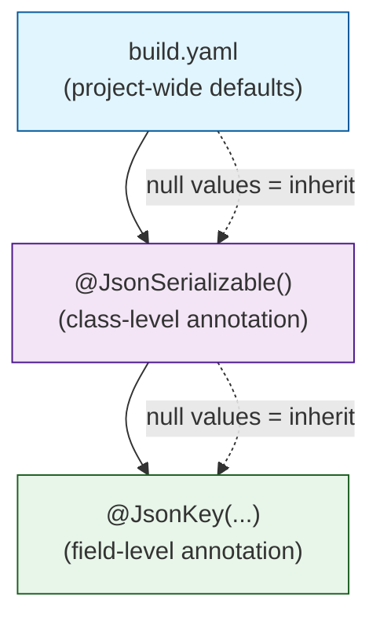

The `@JsonSerializable` class annotation is the **primary entry point** for the `json_serializable` code generation pipeline. Applied to a Dart class, it instructs the `json_serializable` code generator to produce `fromJson` and `toJson` methods, along with optional auxiliary code like JSON key constants, JSON schemas, and per-field serializers. Every configuration option — from field renaming strategies to null-handling behavior — flows through this single annotation, making it the central control surface for the entire serialization contract of a class.

Sources: [json_serializable.dart](json_annotation/lib/src/json_serializable.dart#L34-L41)

---

## Target and Placement

`@JsonSerializable` can only be applied to **classes** — applying it to enums, functions, or other Dart constructs will cause the generator to emit an error at build time. The annotation itself targets `TargetKind.classType` via the `@Target` meta annotation, enforced at compile time by the Dart analyzer.

```dart
@JsonSerializable()
class User {
  String name;
  User({required this.name});
  factory User.fromJson(Map<String, dynamic> json) => _$UserFromJson(json);
  Map<String, dynamic> toJson() => _$UserToJson(this);
}
```

The generated `_$UserFromJson` and `_$UserToJson` functions are placed into the corresponding `.g.dart` part file. This requires the `part` directive to be present in the annotated class's source file.

Sources: [json_serializable.dart](json_annotation/lib/src/json_serializable.dart#L34-L41)

---

## The `FieldRename` Enum

Before examining individual properties, it is important to understand the `FieldRename` enum, which is referenced by the `fieldRename` option. This enum defines five automatic field-to-key renaming strategies:

| Enum Value | Dart Field | JSON Key | Transformation |
|---|---|---|---|
| `FieldRename.none` | `firstName` | `firstName` | No change (default) |
| `FieldRename.kebab` | `firstName` | `first-name` | camelCase → kebab-case |
| `FieldRename.snake` | `firstName` | `first_name` | camelCase → snake_case |
| `FieldRename.pascal` | `firstName` | `FirstName` | camelCase → PascalCase |
| `FieldRename.screamingSnake` | `firstName` | `FIRST_NAME` | camelCase → SCREAMING_SNAKE_CASE |

The `@JsonKey(name: ...)` annotation on individual fields **always takes precedence** over the class-level `fieldRename` setting. This means you can set a default renaming strategy across a class and then override it field-by-field when needed.

Sources: [json_serializable.dart](json_annotation/lib/src/json_serializable.dart#L16-L32)

---

## Properties Reference

All properties of `JsonSerializable` are **nullable** (`bool?`, `String?`, `FieldRename?`, etc.). This is by design: the generator merges annotation values with configuration from `build.yaml`, and a `null` value means "use the default (or the build.yaml override)." Only explicitly set values in the annotation override the corresponding build configuration.

The complete set of defaults (when no annotation or configuration is provided) is:

```dart
JsonSerializable(
  anyMap: false,
  checked: false,
  constructor: '',
  createFactory: true,
  createToJson: true,
  createFieldMap: false,
  createJsonKeys: false,
  createJsonSchema: false,
  createPerFieldToJson: false,
  dateTimeUtc: false,
  disallowUnrecognizedKeys: false,
  explicitToJson: false,
  fieldRename: FieldRename.none,
  genericArgumentFactories: false,
  ignoreUnannotated: false,
  includeIfNull: true,
)
```

Sources: [json_serializable.dart](json_annotation/lib/src/json_serializable.dart#L299-L314), [config_types.dart](json_serializable/lib/src/type_helpers/config_types.dart#L131-L148)

---

### Code Generation Toggles

These boolean properties control **what** the generator produces in the `.g.dart` part file.

| Property | Default | JSON Key (`build.yaml`) | Description |
|---|---|---|---|
| `createFactory` | `true` | `create_factory` | Generates a private `_$ClassFromJson` static function. |
| `createToJson` | `true` | `create_to_json` | Generates a private `_$ClassToJson` static function. |
| `createFieldMap` | `false` | `create_field_map` | Generates a `_$ClassJsonMeta` constant mapping field names to their JSON keys. |
| `createJsonKeys` | `false` | `create_json_keys` | Generates a `_$ClassJsonKeys` class with `String` constants for every JSON key. |
| `createJsonSchema` | `false` | `create_json_schema` | Generates a top-level `_$ClassJsonSchema` constant containing the class's JSON schema. |
| `createPerFieldToJson` | `false` | `create_per_field_to_json` | Generates a `_$ClassPerFieldToJson` abstract class with one static function per field for individual field encoding. |

When `createFactory` is `true`, the generated code produces a top-level function:

```dart
Class _$ClassFromJson(Map<String, dynamic> json) { ... }
```

You then reference this from a factory constructor in your source class:

```dart
factory Class.fromJson(Map<String, dynamic> json) => _$ClassFromJson(json);
```

When `createToJson` is `true`, the generated code produces:

```dart
Map<String, dynamic> _$ClassToJson(Class instance) => { ... };
```

Which you reference from your `toJson` method:

```dart
Map<String, dynamic> toJson() => _$ClassToJson(this);
```

Sources: [json_serializable.dart](json_annotation/lib/src/json_serializable.dart#L68-L131), [config_types.dart](json_serializable/lib/src/type_helpers/config_types.dart#L54-L93)

---

### Null Handling

Two properties control how `null` values behave during serialization:

**`includeIfNull`** (default: `true`) — When `true`, all fields are written to the JSON output even when their value is `null`. When `false`, `null` fields are omitted entirely. This can be overridden at the field level using `@JsonKey(includeIfNull: ...)`.

**`disallowUnrecognizedKeys`** (default: `false`) — When `true`, the generated `fromJson` function will throw an `UnrecognizedKeysException` if the source JSON map contains keys that do not correspond to any field in the class. When `false` (the default), unknown keys are silently ignored. This is useful for catching typos in API responses early.

```dart
@JsonSerializable(disallowUnrecognizedKeys: true)
class StrictModel {
  String name;
  StrictModel({required this.name});
}
// An exception is thrown if JSON contains keys like "naem" or "extra_data"
```

Sources: [json_serializable.dart](json_annotation/lib/src/json_serializable.dart#L230-L244), [allowed_keys_helpers.dart](json_annotation/lib/src/allowed_keys_helpers.dart#L10-L48)

---

### Checked Deserialization

**`checked`** (default: `false`) — When `true`, the generated `fromJson` code wraps deserialization in error-handling wrappers (`$checkedCreate`, `$checkedConvert`, `$checkedNew`). If an exception occurs, it is caught and re-thrown as a `CheckedFromJsonException`, which provides structured information about:

- The **class name** that failed deserialization
- The **JSON key** that caused the error
- The **inner error** message and stack trace
- The **source map** for inspection

This is invaluable for debugging deserialization failures in production, especially when processing data from external APIs where the schema may change unexpectedly.

```dart
@JsonSerializable(checked: true)
class ApiResponse {
  int statusCode;
  String message;
  factory ApiResponse.fromJson(Map<String, dynamic> json) =>
      _$ApiResponseFromJson(json);
}
```

The runtime helpers for checked mode live in [checked_helpers.dart](json_annotation/lib/src/checked_helpers.dart) and are part of the `json_annotation` package — they are imported automatically.

Sources: [json_serializable.dart](json_annotation/lib/src/json_serializable.dart#L52-L57), [checked_helpers.dart](json_annotation/lib/src/checked_helpers.dart#L7-L36)

---

### Field Renaming Strategy

**`fieldRename`** (default: `FieldRename.none`) — Sets the automatic field-to-JSON-key renaming strategy for all fields in the class. See the [FieldRename Enum](#the-fieldrename-enum) section above for the full table of transformations.

```dart
@JsonSerializable(fieldRename: FieldRename.snake)
class UserProfile {
  String firstName;   // JSON key: "first_name"
  String lastName;    // JSON key: "last_name"
  DateTime createdAt; // JSON key: "created_at"
}
```

Individual fields can override this with `@JsonKey(name: ...)`.

Sources: [json_serializable.dart](json_annotation/lib/src/json_serializable.dart#L166-L176)

---

### DateTime Serialization

**`dateTimeUtc`** (default: `false`) — When `true`, all `DateTime` fields are serialized using `DateTime.toUtc().toIso8601String()`. When `false` (the default), `DateTime.toIso8601String()` is used, which preserves the original timezone offset.

This is a class-level setting. For finer control over individual DateTime fields, use `@JsonKey(fromJson: ..., toJson: ...)` with custom conversion functions.

Sources: [json_serializable.dart](json_annotation/lib/src/json_serializable.dart#L132-L137)

---

### Nested Object Serialization

**`explicitToJson`** (default: `false`) — Controls whether the generated `toJson` method recursively calls `.toJson()` on nested objects. The default behavior (`false`) relies on `dart:convert`'s `jsonEncode` automatically calling `toJson` on objects that implement it.

When `true`, the generated code explicitly invokes `.toJson()` on each nested object, producing code like:

```dart
// explicitToJson: false (default)
Map<String, dynamic> toJson() => {'child': child};

// explicitToJson: true
Map<String, dynamic> toJson() => {'child': child?.toJson()};
```

Setting `explicitToJson: true` is recommended when you need the `toJson` output to be fully self-contained — for example, when logging the JSON output, storing it in a database, or when using a serializer that does not automatically call `toJson`.

Sources: [json_serializable.dart](json_annotation/lib/src/json_serializable.dart#L146-L164)

---

### Generic Class Support

**`genericArgumentFactories`** (default: `false`) — When `true` and the annotated class has type parameters, the generated `fromJson` and `toJson` functions receive additional "factory" parameters for each type argument. This allows the generator to delegate serialization of type parameters to the caller.

```dart
@JsonSerializable(genericArgumentFactories: true)
class Page<T> {
  final int number;
  final T content;
  Page({required this.number, required this.content});
  
  factory Page.fromJson(
    Map<String, dynamic> json,
    T Function(Object?) fromJsonT,
  ) => _$PageFromJson(json, fromJsonT);

  Map<String, dynamic> toJson(
    Object? Function(T) toJsonT,
  ) => _$PageToJson(this, toJsonT);
}
```

The generated `_$PageFromJson` then looks like:

```dart
Page<T> _$PageFromJson<T>(
  Map<String, dynamic> json,
  T Function(Object?) fromJsonT,
) => Page(
  number: (json['number'] as num).toInt(),
  content: fromJsonT(json['content']),
);
```

This option has no effect on non-generic classes. If set in `build.yaml` for all classes, it is silently ignored for non-generic ones.

Sources: [json_serializable.dart](json_annotation/lib/src/json_serializable.dart#L178-L221)

---

### Map Type Assumptions

**`anyMap`** (default: `false`) — When `false`, the generated `fromJson` function assumes the input is `Map<String, dynamic>`, which is the standard return type of `jsonDecode` from `dart:convert`. When `true`, the generator does not make this assumption and instead accepts `Map<dynamic, dynamic>`, allowing JSON-like maps from sources such as `package:yaml`.

This increases the generated code size slightly because it must handle dynamic keys.

Sources: [json_serializable.dart](json_annotation/lib/src/json_serializable.dart#L42-L50)

---

### Constructor Targeting

**`constructor`** (default: `''`, empty string) — Specifies which named constructor to target for `fromJson` deserialization. When empty or unset, the default (unnamed) constructor is used. This only has effect when `createFactory` is `true`.

```dart
@JsonSerializable(constructor: 'named')
class MyClass {
  final int value;
  MyClass.named({required this.value});
  factory MyClass.fromJson(Map<String, dynamic> json) =>
      _$MyClassFromJson(json);
}
```

Sources: [json_serializable.dart](json_annotation/lib/src/json_serializable.dart#L59-L66)

---

### Selective Field Generation

**`ignoreUnannotated`** (default: `false`) — When `true`, only fields that are explicitly annotated with `@JsonKey` will have serialization code generated. Unannotated fields are completely ignored — equivalent to setting both `@JsonKey(includeFromJson: false)` and `@JsonKey(includeToJson: false)` on every unannotated field.

This is useful when you want fine-grained control over which fields participate in serialization without annotating every excluded field individually.

Sources: [json_serializable.dart](json_annotation/lib/src/json_serializable.dart#L223-L228)

---

### Class-Level Converters

**`converters`** (default: `null`) — A list of `JsonConverter` instances to apply to the entire class. This is equivalent to placing individual `@JsonConverter` annotations on the class, but enables reuse of a custom `JsonSerializable` annotation across multiple classes:

```dart
const customConfig = JsonSerializable(
  converters: [DateTimeEpochConverter()],
);

@customConfig
class Order { ... }

@customConfig
class Invoice { ... }
```

The `converters` property is annotated with `@JsonKey(includeFromJson: false, includeToJson: false)` to prevent it from appearing in the generated code for `JsonSerializable` itself.

Sources: [json_serializable.dart](json_annotation/lib/src/json_serializable.dart#L240-L272)

---

## Configuration Hierarchy

The generator resolves effective configuration through a three-tier hierarchy. Each tier can override values from the one above it:



When you set `createToJson: false` in `build.yaml`, **all** classes in that build scope will default to not generating `toJson`. You can then opt in per-class:

```json
// build.yaml
targets:
  $default:
    builders:
      json_serializable:
        options:
          create_to_json: false  # project-wide default
```

```dart
// This class inherits create_to_json: false from build.yaml
@JsonSerializable()
class InternalModel { ... }

// This class overrides with create_to_json: true
@JsonSerializable(createToJson: true)
class PublicApiModel { ... }
```

The `ClassConfig` in the generator merges annotation values with build configuration, applying `ClassConfig.defaults` as the final fallback for any property that remains `null` after both tiers.

Sources: [config_types.dart](json_serializable/lib/src/type_helpers/config_types.dart#L95-L127), [builder.dart](json_serializable/lib/builder.dart#L24-L49)

---

## Annotation JSON Mapping for build.yaml

When configuring `json_serializable` through `build.yaml`, option names use **snake_case** rather than the Dart camelCase property names:

| Dart Property | `build.yaml` Key |
|---|---|
| `anyMap` | `any_map` |
| `checked` | `checked` |
| `constructor` | `constructor` |
| `createFactory` | `create_factory` |
| `createFieldMap` | `create_field_map` |
| `createJsonKeys` | `create_json_keys` |
| `createJsonSchema` | `create_json_schema` |
| `createPerFieldToJson` | `create_per_field_to_json` |
| `createToJson` | `create_to_json` |
| `dateTimeUtc` | `date_time_utc` |
| `disallowUnrecognizedKeys` | `disallow_unrecognized_keys` |
| `explicitToJson` | `explicit_to_json` |
| `fieldRename` | `field_rename` |
| `genericArgumentFactories` | `generic_argument_factories` |
| `ignoreUnannotated` | `ignore_unannotated` |
| `includeIfNull` | `include_if_null` |

The `converters` property is not configurable through `build.yaml` — it can only be set via the annotation itself.

Sources: [json_serializable.g.dart](json_annotation/lib/src/json_serializable.g.dart#L74-L89)

---

## Minimal Example

Here is a complete, annotated class demonstrating the most common patterns:

```dart
@JsonSerializable(
  fieldRename: FieldRename.snake,
  explicitToJson: true,
  includeIfNull: false,
)
class Product {
  final int id;
  final String name;
  final double? price;
  final DateTime createdAt;
  final List<String> tags;

  Product({
    required this.id,
    required this.name,
    this.price,
    required this.createdAt,
    this.tags = const [],
  });

  factory Product.fromJson(Map<String, dynamic> json) =>
      _$ProductFromJson(json);

  Map<String, dynamic> toJson() => _$ProductToJson(this);
}
```

This produces JSON like:

```json
{
  "id": 42,
  "name": "Widget",
  "price": 9.99,
  "created_at": "2025-01-15T10:30:00.000",
  "tags": ["sale", "featured"]
}
```

Note how `price` is excluded when null (due to `includeIfNull: false`), and all field names are converted to `snake_case` (due to `fieldRename: FieldRename.snake`).

Sources: [json_serializable.dart](json_annotation/lib/src/json_serializable.dart#L274-L294)

---

## See Also

- **Next**: [JsonKey Field Annotation Reference](5-jsonkey-field-annotation-reference) — for per-field control over serialization behavior, custom names, default values, and conversion functions.
- **Related**: [JsonConverter for Custom Type Serialization](7-jsonconverter-for-custom-type-serialization) — for reusable conversion logic across types.
- **Related**: [Generic Classes with genericArgumentFactories](19-generic-classes-with-genericargumentfactories) — a deep dive into serializing generic classes.
- **Related**: [Checked Deserialization for Safer fromJson](20-checked-deserialization-for-safer-fromjson) — a deep dive into the `checked` mode and `CheckedFromJsonException`.
- **Related**: [Settings, Configuration Merging, and ClassConfig Internals](24-settings-configuration-merging-and-classconfig-internals) — how the generator resolves effective configuration from annotation and build.yaml.