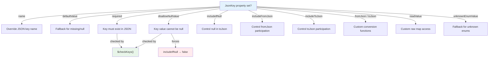

The `@JsonKey()` annotation is the field-level customization mechanism in the `json_serializable` ecosystem. While the class-level `@JsonSerializable()` sets global behavior for a class, `@JsonKey()` gives you precise, per-field control over how individual fields are serialized to and from JSON. This page documents every property of the `JsonKey` class, explains its interaction with the code generator, and provides practical usage patterns drawn from the repository's own test suite and examples.

Sources: [json_annotation/lib/src/json_key.dart](json_annotation/lib/src/json_key.dart#L10-L15)

## Where @JsonKey Can Be Applied

The `@JsonKey` annotation targets three Dart language constructs:

| Target | Description | Example |
|--------|-------------|---------|
| **Field** | A declared class field | `@JsonKey(name: 'date-of-birth') final DateTime dateOfBirth;` |
| **Getter** | A computed property accessor | `@JsonKey(name: 'datetime-iterable') Iterable<DateTime> get dateTimeIterable` |
| **Constructor parameter** | A named or positional parameter in the primary constructor | `@JsonKey(name: 'no-42') this.ctorValidatedNo42` |

The `@Target` annotation on the class enforces this constraint at the analyzer level, so you will get a compile-time error if you try to place it on a method or a local variable.

When both the field and its corresponding constructor parameter carry separate `@JsonKey` annotations, the constructor parameter's annotation takes precedence. The generator logs a warning if the two annotations conflict.

Sources: [json_annotation/lib/src/json_key.dart#L14-L14](json_annotation/lib/src/json_key.dart#L14-L14), [json_serializable/lib/src/json_key_utils.dart#L28-L50](json_serializable/lib/src/json_key_utils.dart#L28-L50)

## Complete Property Reference

The `JsonKey` constructor accepts **13 named parameters** (plus 1 deprecated). The table below summarizes every property, its type, default behavior, and the primary use case.

| Property | Type | Default | Purpose |
|----------|------|---------|---------|
| `name` | `String?` | `null` (uses field name) | Override the JSON key name for this field |
| `defaultValue` | `Object?` | `null` | Value used when the JSON key is missing or its value is `null` |
| `required` | `bool?` | `false` | Throw `MissingRequiredKeysException` if the JSON key is absent |
| `disallowNullValue` | `bool?` | `false` | Throw `DisallowedNullValueException` if the key exists but its value is `null` |
| `includeIfNull` | `bool?` | `null` (inherits from class) | Whether `null` values appear in the serialized JSON output |
| `includeFromJson` | `bool?` | `null` (default semantics) | Force-include or force-exclude a field during deserialization |
| `includeToJson` | `bool?` | `null` (default semantics) | Force-include or force-exclude a field during serialization |
| `fromJson` | `Function?` | `null` | A function to decode this field's JSON value |
| `toJson` | `Function?` | `null` | A function to encode this field to a JSON-compatible value |
| `readValue` | `Object? Function(Map, String)?` | `null` | Customize how the raw value is read from the JSON map before decoding |
| `unknownEnumValue` | `Enum?` | `null` | Fallback enum value when the JSON value doesn't match any enum member |
| `ignore` | `bool?` | `null` | **Deprecated** — use `includeFromJson`/`includeToJson: false` instead |
| `nullable` | `bool?` | — | **Deprecated** — has no effect |

Sources: [json_annotation/lib/src/json_key.dart#L15-L182](json_annotation/lib/src/json_key.dart#L15-L182)

## Detailed Property Guide

### name — Custom JSON Key Names

The `name` property overrides the JSON key used when reading and writing a field. By default, the generator uses the Dart field name verbatim. Setting `name` lets you map a Dart field to a differently-spelled or hyphenated JSON key.

This is the most commonly used `@JsonKey` property. In the `Person` example, the Dart field `dateOfBirth` maps to the JSON key `"date-of-birth"`:

```dart
@JsonKey(name: 'date-of-birth')
final DateTime dateOfBirth;
```

The generated code then reads `json['date-of-birth']` instead of `json['dateOfBirth']`:

```dart
// Generated fromJson reads the hyphenated key
DateTime.parse(json['date-of-birth'] as String),

// Generated toJson writes the hyphenated key
'date-of-birth': instance.dateOfBirth.toIso8601String(),
```

The `name` parameter can also contain special characters like `$`, as demonstrated by the `Person` class that maps to `r'$house'`:

```dart
@JsonKey(name: '\$house')
final Category house;
```

Sources: [example/lib/example.dart#L16-L17](example/lib/example.dart#L16-L17), [json_serializable/test/integration/json_test_example.dart#L20-L21](json_serializable/test/integration/json_test_example.dart#L20-L21), [example/lib/example.g.dart#L12-L12](example/lib/example.g.dart#L12-L12)

### defaultValue — Fallback Values for Missing or Null Data

The `defaultValue` property specifies what to use when the JSON source does not contain the key, or when the value at that key is `null`. It accepts **literal values**, **enum values**, **top-level or static functions**, and **constructors with no required parameters**.

The generated code applies the default using the `??` operator, so the fallback is a clean one-liner:

```dart
// Source annotation
@JsonKey(defaultValue: 42)
int fieldInt;

// Generated code — uses the ?? operator for the fallback
(json['fieldInt'] as num?)?.toInt() ?? 42,
```

The full spectrum of supported default value forms:

| Form | Example | Generated Code Pattern |
|------|---------|----------------------|
| Literal (bool, int, double, String) | `defaultValue: true` | `json['field'] as bool? ?? true` |
| List literal | `defaultValue: [1, 2, 3]` | `... ?? [1, 2, 3]` |
| Set literal | `defaultValue: {'a', 'b'}` | `... ?? {'a', 'b'}` |
| Map literal | `defaultValue: {'answer': 42}` | `... ?? {'answer': 42}` |
| Nested collection literal | `defaultValue: {'root': ['child']}` | `... ?? {'root': ['child']}` |
| Enum value | `defaultValue: Greek.beta` | `$enumDecodeNullable(...) ?? Greek.beta` |
| Top-level function | `defaultValue: intDefaultValueFunction` | `... ?? intDefaultValueFunction()` |
| Default constructor | `defaultValue: ConstClass.new` | `... ?? ConstClass()` |
| Named constructor | `defaultValue: ConstClass.easy` | `... ?? ConstClass.easy()` |
| Const expression | `defaultValue: _intValue` | `... ?? 42` (resolved at compile time) |

Sources: [json_serializable/test/default_value/default_value.dart#L28-L85](json_serializable/test/default_value/default_value.dart#L28-L85), [json_serializable/test/default_value/default_value.g.dart#L11-L66](json_serializable/test/default_value/default_value.g.dart#L11-L66)

### required — Enforcing Key Presence

Setting `required: true` causes the generated `fromJson` to verify that the JSON map contains the associated key. If the key is missing, a `MissingRequiredKeysException` is thrown. Note that only the **existence** of the key is checked — a key with a `null` value is still considered valid.

```dart
@JsonKey(required: true)
final int value;

@JsonKey(name: 'custom_field', required: true)
final String customField;
```

When the JSON is decoded, the generated code calls `$checkKeys()` with a list of required keys. If any are absent, the exception carries the list of missing keys for clear diagnostics.

Sources: [json_serializable/test/kitchen_sink/strict_keys_object.dart#L11-L15](json_serializable/test/kitchen_sink/strict_keys_object.dart#L11-L15), [json_annotation/lib/src/allowed_keys_helpers.dart#L10-L33](json_annotation/lib/src/allowed_keys_helpers.dart#L10-L33)

### disallowNullValue — Rejecting Null While Allowing Absence

Setting `disallowNullValue: true` causes the generated code to throw a `DisallowedNullValueException` if the JSON map **contains** the key but its value is `null`. A JSON map that **lacks** the key entirely is treated normally (the field will be `null` or use `defaultValue`).

This is subtly different from `required`. The interaction is:

| Scenario | `required: true` | `disallowNullValue: true` |
|----------|------------------|--------------------------|
| Key is **absent** | Throws `MissingRequiredKeysException` | Field defaults normally |
| Key exists, value is **null** | Valid (key exists) | Throws `DisallowedNullValueException` |
| Key exists, value is **non-null** | Valid | Valid |

When `disallowNullValue` is `true`, `includeIfNull` is forced to `false` to maintain consistency between `toJson` and `fromJson`. Setting both `disallowNullValue: true` and `includeIfNull: true` on the same field throws a generation error.

Sources: [json_annotation/lib/src/json_key.dart#L25-L35](json_annotation/lib/src/json_key.dart#L25-L35), [json_serializable/lib/src/json_key_utils.dart#L320-L328](json_serializable/lib/src/json_key_utils.dart#L320-L328), [json_serializable/test/integration/json_test_example.dart#L56-L57](json_serializable/test/integration/json_test_example.dart#L56-L57)

### includeIfNull — Null Value Serialization Control

The `includeIfNull` property controls whether a field with a `null` value is included in the `toJson` output. When set to `false`, null-valued fields are omitted from the JSON map entirely.

```dart
@JsonSerializable(includeIfNull: false)
class Order {
  @JsonKey(includeIfNull: false)
  final String? middleName;
}
```

The generated `toJson` uses Dart's collection-if element (`?instance.field`) to conditionally include the entry:

```dart
// Generated toJson with includeIfNull: false
'middleName': ?instance.middleName,
```

When `includeIfNull` is `null` (the default), the behavior is inherited from the enclosing class's `@JsonSerializable(includeIfNull: ...)` annotation.

Sources: [json_annotation/lib/src/json_key.dart#L75-L90](json_annotation/lib/src/json_key.dart#L75-L90), [example/lib/example.dart#L12-L13](example/lib/example.dart#L12-L13)

### includeFromJson and includeToJson — Selective Serialization

These two properties replace the deprecated `ignore` parameter and provide fine-grained control over which direction a field participates in:

| Value | `includeFromJson` | `includeToJson` |
|-------|-------------------|-----------------|
| `null` (default) | Default semantics: public fields are decoded, private fields are skipped unless `ignoreUnannotated` is `false` | Default semantics: public fields are encoded |
| `true` | Force decode, even for private fields | Force encode, even for private fields |
| `false` | Skip this field during fromJson | Skip this field during toJson |

This lets you create fields that are only read from JSON but never written back, or vice versa:

```dart
// This field is decoded from JSON but never written to toJson output
@JsonKey(includeFromJson: false, includeToJson: false)
final String? ignoredName;
```

The field matrix test in the repository exhaustively verifies every combination of `includeFromJson` and `includeToJson` for both public and private fields, confirming the behavior matrix:

| `includeToJson` | `includeFromJson` | Public Field | Private Field |
|-----------------|-------------------|--------------|---------------|
| `null` | `null` | Read + Write | Skip both |
| `null` | `true` | Read + Write | Read only |
| `null` | `false` | Write only | Skip both |
| `true` | `null` | Read + Write | Write only |
| `true` | `true` | Read + Write | Read + Write |
| `true` | `false` | Write only | Write only |
| `false` | `null` | Read only | Skip both |
| `false` | `true` | Read only | Read only |
| `false` | `false` | Skip both | Skip both |

Sources: [json_annotation/lib/src/json_key.dart#L63-L102](json_annotation/lib/src/json_key.dart#L63-L102), [json_serializable/test/field_matrix_test.field_matrix.dart#L30-L100](json_serializable/test/field_matrix_test.field_matrix.dart#L30-L100), [json_serializable/test/integration/json_keys_example.dart#L16-L17](json_serializable/test/integration/json_keys_example.dart#L16-L17)

### fromJson and toJson — Custom Serialization Functions

The `fromJson` and `toJson` properties accept **top-level functions**, **static methods**, or **constructors** that handle conversion for a specific field. They let you write custom logic without creating a full `JsonConverter` class.

**`fromJson`** must be a function that accepts one positional argument (the raw JSON value) and returns a type compatible with the annotated field. **`toJson`** must accept the field's type and return a JSON-compatible value.

```dart
@JsonKey(
  name: 'prep-time',
  fromJson: _durationFromMilliseconds,
  toJson: _durationToMilliseconds,
)
Duration? prepTime;

static Duration? _durationFromMilliseconds(int? milliseconds) =>
    milliseconds == null ? null : Duration(milliseconds: milliseconds);

static int? _durationToMilliseconds(Duration? duration) =>
    duration?.inMilliseconds;
```

This pattern converts a `Duration` to/from an integer of milliseconds in the JSON.

When you set `fromJson`, it is strongly recommended to also set `toJson` to ensure round-trip consistency. The generator will apply the custom function during both encoding and decoding.

Sources: [example/lib/example.dart#L45-L50](example/lib/example.dart#L45-L50), [json_serializable/test/integration/converter_examples.dart#L19-L20](json_serializable/test/integration/converter_examples.dart#L19-L20)

### readValue — Customizing Raw Map Access

The `readValue` property is a powerful escape hatch that customizes **how a value is fetched from the JSON map** before any decoding logic runs. It receives the entire JSON map and the key name, and must return the raw value to pass downstream.

This is useful for:
- Supporting **alternative key names** (fallback keys)
- Accessing **multiple JSON values** at once for a single Dart field
- Implementing **migration logic** between JSON schema versions

```dart
Object? _valueAccessor(Map json, String key) {
  if (key == 'iterable') {
    return json['iterable'] ?? json['theIterable'];
  }
  return json[key];
}

@JsonKey(readValue: _valueAccessor)
Iterable? get iterable => _iterable;
```

In this example, the generator first calls `_valueAccessor(json, 'iterable')` to obtain the raw value, and then applies the standard decoding logic (type casting, collection mapping, etc.) to that returned value.

The function must be a **top-level function** or a **static method** — instance methods are not supported because the generator cannot reference them in the emitted code.

Sources: [json_annotation/lib/src/json_key.dart#L110-L123](json_annotation/lib/src/json_key.dart#L110-L123), [json_serializable/test/kitchen_sink/kitchen_sink.dart#L82-L88](json_serializable/test/kitchen_sink/kitchen_sink.dart#L82-L88), [json_serializable/test/kitchen_sink/kitchen_sink.dart#L133-L134](json_serializable/test/kitchen_sink/kitchen_sink.dart#L133-L134)

### unknownEnumValue — Handling Unrecognized Enum Data

The `unknownEnumValue` property specifies a fallback enum value to use when the JSON contains a value that does not match any member of the target enum. This is particularly valuable when consuming APIs that may introduce new enum values after your code was compiled.

```dart
@JsonKey(
  name: 'status_code',
  defaultValue: StatusCode.success,
  unknownEnumValue: StatusCode.unknown,
)
StatusCode? statusCode;
```

The generated code passes the `unknownValue` parameter to `$enumDecodeNullable`:

```dart
// Generated fromJson
$enumDecodeNullable(
  _$StatusCodeEnumMap,
  json['status_code'],
  unknownValue: StatusCode.unknown,
) ?? StatusCode.success;
```

For nullable enum fields, you can use the special sentinel `JsonKey.nullForUndefinedEnumValue` to assign `null` instead of a specific enum member:

```dart
@JsonKey(unknownEnumValue: JsonKey.nullForUndefinedEnumValue)
MyEnum? field;
```

This sentinel is a static constant on the `JsonKey` class — it is not a real enum value but a type-system trick that the generator recognizes. It cannot be combined with `defaultValue`.

Sources: [json_annotation/lib/src/json_key.dart#L146-L153](json_annotation/lib/src/json_key.dart#L146-L153), [json_serializable/test/integration/json_test_example.dart#L69-L73](json_serializable/test/integration/json_test_example.dart#L69-L73), [json_serializable/lib/src/json_key_utils.dart#L192-L211](json_serializable/lib/src/json_key_utils.dart#L192-L211)

## Property Interaction Rules

Several `JsonKey` properties interact with each other and with the class-level `@JsonSerializable` annotation. Understanding these interactions prevents generation errors and subtle bugs.



**Critical interactions to remember:**

| Combination | Behavior |
|-------------|----------|
| `disallowNullValue: true` + `includeIfNull: true` | **Error at generation time** — incompatible settings |
| `disallowNullValue: true` + `includeIfNull: null` | `includeIfNull` is forced to `false` |
| `required: true` + `defaultValue` | Both apply: the key must exist, but if the value is `null`, the default is used |
| `fromJson` set without `toJson` | Works but breaks round-trip consistency — the generator will still create `toJson` using default logic |
| `includeFromJson` + deprecated `ignore` | **Error at generation time** — use only `includeFromJson` |
| `unknownEnumValue` + `defaultValue` | Both apply: unknown values use `unknownEnumValue`, missing keys use `defaultValue` |

Sources: [json_serializable/lib/src/json_key_utils.dart#L307-L345](json_serializable/lib/src/json_key_utils.dart#L307-L345), [json_serializable/lib/src/json_key_utils.dart#L347-L357](json_serializable/lib/src/json_key_utils.dart#L347-L357)

## How the Generator Processes @JsonKey

The code generator resolves `@JsonKey` annotations through a multi-step process implemented in `json_key_utils.dart`. Understanding this pipeline helps you predict how your annotations will behave.

1. **Annotation extraction**: The generator reads the `@JsonKey` annotation from both the field element and the corresponding constructor parameter (if one exists).

2. **Precedence resolution**: If both the field and the constructor parameter carry `@JsonKey` annotations, the **constructor parameter wins**. A warning is logged if values conflict.

3. **Validation**: The generator checks for invalid combinations (e.g., `disallowNullValue` + `includeIfNull`) and throws `InvalidGenerationSourceError` with helpful messages.

4. **Merging with class defaults**: Properties left as `null` in the `@JsonKey` annotation fall back to values from `@JsonSerializable` (for `includeIfNull`) or to the generator's default semantics (for `includeFromJson`/`includeToJson` based on field visibility).

5. **KeyConfig creation**: All resolved values are packaged into a `KeyConfig` object that the `DecodeHelper` and `EncodeHelper` consult when emitting the `fromJson` and `toJson` code.

Sources: [json_serializable/lib/src/json_key_utils.dart#L20-L24](json_serializable/lib/src/json_key_utils.dart#L20-L24), [json_serializable/lib/src/type_helpers/config_types.dart#L10-L48](json_serializable/lib/src/type_helpers/config_types.dart#L10-L48)

## Practical Patterns

### Pattern: Aliasing with name

Map your Dart fields to any JSON key naming convention without renaming your Dart code:

```dart
@JsonKey(name: 'user_id')      int userId;
@JsonKey(name: 'firstName')     String firstName;  // camelCase JSON
@JsonKey(name: 'created_at')    DateTime createdAt; // snake_case JSON
@JsonKey(name: 'is-active')     bool isActive;      // kebab-case JSON
```

Sources: [example/lib/example.dart#L16-L17](example/lib/example.dart#L16-L17), [json_serializable/test/kitchen_sink/kitchen_sink.dart#L100-L101](json_serializable/test/kitchen_sink/kitchen_sink.dart#L100-L101)

### Pattern: Nullable collection with empty default

Combine `defaultValue` with nullable fields to ensure collections are never null in your domain model:

```dart
@JsonKey(defaultValue: [])
List<int> scores;

@JsonKey(defaultValue: {})
Map<String, String> metadata;
```

Sources: [json_serializable/test/default_value/default_value.dart#L40-L56](json_serializable/test/default_value/default_value.dart#L40-L56)

### Pattern: Read-only computed fields

Fields that are derived from other data should be excluded from both serialization directions:

```dart
@JsonKey(includeFromJson: false, includeToJson: false)
String get fullName => '$firstName $lastName';

@JsonKey(includeFromJson: false, includeToJson: false)
int get price => items!.fold(0, (total, item) => item.price! + total);
```

Sources: [json_serializable/test/integration/json_test_example.dart#L76-L77](json_serializable/test/integration/json_test_example.dart#L76-L77), [json_serializable/test/integration/json_test_example.dart#L84-L84](json_serializable/test/integration/json_test_example.dart#L84-L84)

### Pattern: Safe enum deserialization

Protect your application from breaking when an API returns an unexpected enum value:

```dart
@JsonKey(
  unknownEnumValue: StatusCode.unknown,
  defaultValue: StatusCode.success,
)
StatusCode? statusCode;
```

Sources: [json_serializable/test/integration/json_test_example.dart#L69-L73](json_serializable/test/integration/json_test_example.dart#L69-L73)

## Next Steps

Having understood how to customize individual fields, you may want to explore:

- **[JsonEnum, JsonValue, and JsonLiteral Annotations](6-jsonenum-jsonvalue-and-jsonliteral-annotations)** — for enum-level and literal-value serialization control
- **[JsonConverter for Custom Type Serialization](7-jsonconverter-for-custom-type-serialization)** — for creating reusable, type-safe converters as an alternative to per-field `fromJson`/`toJson` functions
- **[JsonSerializable Class Annotation Reference](4-jsonserializable-class-annotation-reference)** — for class-level settings that interact with `@JsonKey` properties like `includeIfNull` and `fieldRename`