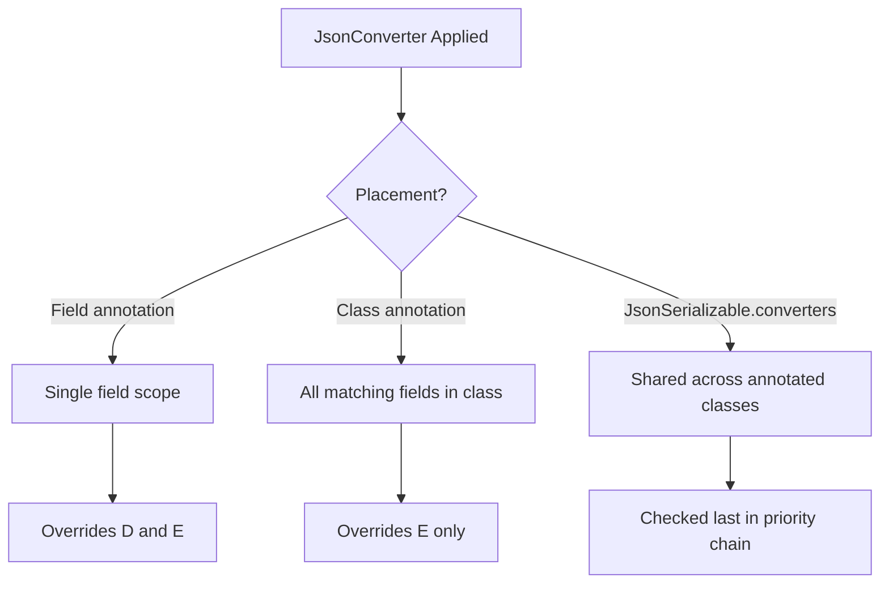
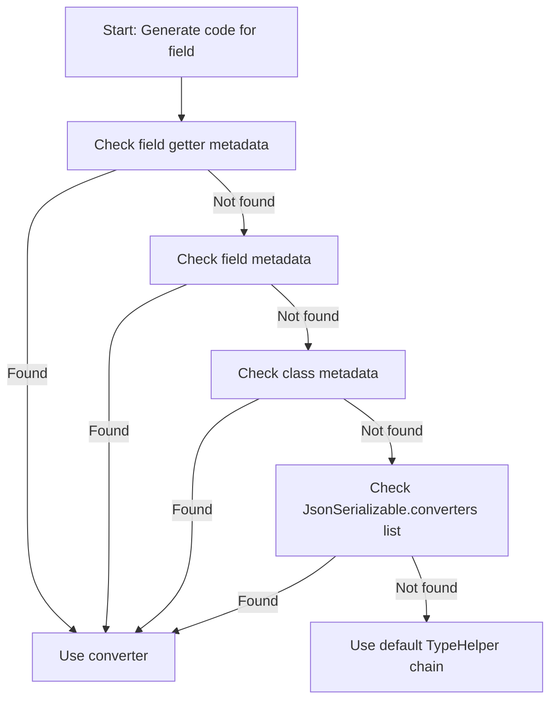
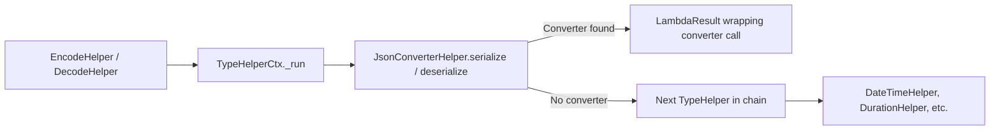

The `JsonConverter<T, S>` interface is the primary mechanism for handling types that `json_serializable` cannot serialize or deserialize out of the box. By implementing this abstract class, you define a bidirectional mapping between your custom Dart type `T` and a JSON-compatible representation `S`. The code generator detects `JsonConverter` implementations and wraps field access in the appropriate `fromJson` / `toJson` calls, eliminating the need for manual transformation logic scattered across your model classes.

---

## The Converter Interface Contract

`JsonConverter<T, S>` declares exactly two methods: `fromJson(S json)` returning `T`, and `toJson(T object)` returning `S`. The generic parameter `S` must be a valid JSON primitive or structure — typically `String`, `int`, `double`, `bool`, `Map<String, dynamic>`, `List<dynamic>`, or `null`. The constant constructor requirement ensures converters can be used as annotations.

Sources: [json_annotation/lib/src/json_converter.dart](json_annotation/lib/src/json_converter.dart#L45-L50)

---

## Three Placement Strategies

Converters can be applied at three distinct scopes, each with different inheritance and reuse characteristics. Understanding these placement strategies determines how broadly a converter's transformation logic is shared across your model classes.

| Placement | Syntax | Scope | Reuse Pattern |
|-----------|--------|-------|---------------|
| **Field-level** | `@MyConverter()` on a field | Single field only | Narrowest; overrides any class-level converter |
| **Class-level** | `@MyConverter()` on the class | All matching fields in the class | Medium; convenient for class-specific types |
| **Annotation parameter** | `@JsonSerializable(converters: [MyConverter()])` | All matching fields across multiple classes | Broadest; pairs with custom `JsonSerializable` constants |

Sources: [json_annotation/lib/src/json_converter.dart](json_annotation/lib/src/json_converter.dart#L13-L44)



### Field-level annotation

A converter placed directly on a field takes highest precedence. This is useful when a single field needs custom serialization but other fields of the same type in the same class should use the default handling.

```dart
@JsonSerializable()
class Order {
  @EpochDateTimeConverter()
  final DateTime createdAt;
  
  final DateTime updatedAt; // uses default DateTime serialization
}
```

Sources: [example/lib/json_converter_example.dart](example/lib/json_converter_example.dart#L48)

### Class-level annotation

Placing the converter on the class applies it to every field whose type matches the converter's `T` parameter. This is appropriate when an entire class consistently uses a non-standard representation for a specific type.

```dart
@JsonSerializable()
@_DateTimeEpochConverter()
class DateTimeExample {
  final DateTime when;
  // ...
}
```

Sources: [example/lib/json_converter_example.dart](example/lib/json_converter_example.dart#L13-L14)

### JsonSerializable.converters parameter

The `converters` list on `@JsonSerializable` allows defining a reusable annotation constant that bundles converter configuration with other generator settings. This is the most efficient strategy when multiple classes share the same converter requirements.

```dart
const myAnnotation = JsonSerializable(
  converters: [MyJsonConverter()],
);

@myAnnotation
class FirstModel { /* ... */ }

@myAnnotation
class SecondModel { /* ... */ }
```

Sources: [json_annotation/lib/src/json_serializable.dart](json_annotation/lib/src/json_serializable.dart#L240-L272)

---

## Converter Resolution Priority

The generator searches for a compatible converter in a specific order. The search terminates at the first match, so knowing this precedence prevents subtle configuration bugs.



The generator first inspects the field's getter metadata, then the field itself, then the class, and finally the `converters` list in `ClassConfig`. A second matching converter at any level causes an `InvalidGenerationSourceError` with the message "Found more than one matching converter for `<type>`."

Sources: [json_serializable/lib/src/type_helpers/json_converter_helper.dart](json_serializable/lib/src/type_helpers/json_converter_helper.dart#L159-L198)

---

## Type Compatibility and Matching Rules

The generator matches converters to fields using structural type analysis. A converter `JsonConverter<T, S>` is considered compatible with a field of type `TargetType` when one of two conditions holds:

1. **Exact or assignable match**: `T` is the same as `TargetType`, or `TargetType` is assignable to `T` after null-safety promotion.
2. **Generic parameter match**: Both `T` and `TargetType` are `TypeParameterType` instances — this enables generic converters that work across type parameters.

| Scenario | `T` | `TargetType` | Match? | Notes |
|----------|-----|-------------|--------|-------|
| Exact type | `DateTime` | `DateTime` | ✅ | Direct match |
| Nullable target | `DateTime` | `DateTime?` | ✅ | Non-nullable converter applied to nullable field |
| Non-nullable target, nullable converter | `DateTime?` | `DateTime` | ❌ | Throws error at generation time |
| Generic parameter | `T` | `T` | ✅ | Both are type parameters |
| Generic parameter | `T` | `S` | ❌ | Different type parameter names |
| Unrelated types | `DateTime` | `int` | ❌ | No match, falls through to next converter |

The generator also validates that a converter's `JsonConverter` class has at most one type parameter. A converter with two or more generic parameters produces: `JsonConverter implementations can have no more than one type argument.`

Sources: [json_serializable/lib/src/type_helpers/json_converter_helper.dart](json_serializable/lib/src/type_helpers/json_converter_helper.dart#L279-L332)

---

## Nullable Type Handling

A subtle but critical aspect of `JsonConverter` support is the interaction between converter nullability and field nullability. When a field is nullable but the converter's `S` type (the JSON representation) is non-nullable, the generator introduces a helper function to safely bridge the gap.

For nullable fields with non-nullable JSON types, the generator emits a `_$JsonConverterFromJson` helper:

```dart
Value? _$JsonConverterFromJson<Json, Value>(
  Object? json,
  Value? Function(Json json) fromJson,
) => json == null ? null : fromJson(json as Json);
```

And the corresponding `_$JsonConverterToJson`:

```dart
Json? _$JsonConverterToJson<Json, Value>(
  Value? value,
  Json? Function(Value value) toJson,
) => value == null ? null : toJson(value);
```

These helpers are generated as top-level members only when needed, preventing null-pointer exceptions when converting nullable fields.

Sources: [json_serializable/test/generic_files/generic_class.g.dart](json_serializable/test/generic_files/generic_class.g.dart#L80-L88)

---

## Nullable-to-NonNullable Mismatch Errors

If a converter's `S` type is nullable but the target field requires non-nullable output (and no `defaultValue` is set), generation fails. This is by design: the generator cannot guarantee that the converter will produce a valid value when the JSON input is `null`.

```dart
// This will throw at generation time:
@JsonConverterNullableToNonNullable()
@JsonSerializable()
class Bad {
  late NeedsConversion value;
}

class _NullableConverter implements JsonConverter<NeedsConversion?, Object?> {
  const _NullableConverter();
  @override
  NeedsConversion? fromJson(Object? json) => null;
  @override
  Object? toJson(NeedsConversion? object) => null;
}
```

The error message explicitly guides you: "To support the type `NeedsConversion` you can: Use `JsonConverter`... Use `JsonKey` fields `fromJson` and `toJson`..."

Sources: [json_serializable/test/src/json_converter_test_input.dart](json_serializable/test/src/json_converter_test_input.dart#L205-L223)

---

## Generic Converter Support

Converters can themselves be generic, enabling a single converter class to handle any type parameter `T`. The generator instantiates the generic converter with the concrete type argument from the field, producing type-safe calls.

```dart
class _SimpleConverter<T> implements JsonConverter<T, Map<String, dynamic>> {
  const _SimpleConverter();
  @override
  T fromJson(Map<String, dynamic> json) => json['value'] as T;
  @override
  Map<String, dynamic> toJson(T object) => {'value': object};
}
```

When applied to a generic class field `T? fieldT`, the generated code becomes:

```dart
..fieldT = _$JsonConverterFromJson<Map<String, dynamic>, T>(
  json['fieldT'],
  _SimpleConverter<T?>().fromJson,
)
```

The converter is instantiated with the type parameter preserved, ensuring runtime type safety. This pattern requires that the converter class itself declares a type parameter — the generator validates this constraint.

Sources: [json_serializable/test/generic_files/generic_class.dart](json_serializable/test/generic_files/generic_class.dart#L84-L92)
Sources: [json_serializable/test/generic_files/generic_class.g.dart](json_serializable/test/generic_files/generic_class.g.dart#L43-L50)

---

## Named Constructor Support

Converters are not limited to the default constructor. Named constructors can be used via annotation syntax, and the generator preserves the exact accessor path in the generated code.

```dart
@JsonSerializable()
@_DurationMillisecondConverter.named()
class Model {
  late Duration value;
}

class _DurationMillisecondConverter implements JsonConverter<Duration, int> {
  const _DurationMillisecondConverter.named();
  // ...
}
```

Generated code references the named constructor:

```dart
..value = const _DurationMillisecondConverter.named().fromJson(
  (json['value'] as num).toInt(),
)
```

Static factory methods and getters are also supported through `PropertyAccessorElement` handling. When a converter reference resolves to a static property, the generator uses the property access string directly (e.g., `_durationConverter.fromJson(...)`).

Sources: [json_serializable/test/src/json_converter_test_input.dart](json_serializable/test/src/json_converter_test_input.dart#L36-L49)
Sources: [json_serializable/lib/src/type_helpers/json_converter_helper.dart](json_serializable/lib/src/type_helpers/json_converter_helper.dart#L218-L233)

---

## Constructor Parameter Restrictions

Converters used as annotations must have zero-argument constructors (either the default or a named constructor with no parameters). The generator explicitly rejects converters that require constructor arguments:

```dart
@ShouldThrow('Generators with constructor arguments are not supported.')
@JsonSerializable()
@_ConverterWithCtorParams(42)
class JsonConverterCtorParams {
  late Duration value;
}
```

This restriction exists because annotations must be constant expressions. If you need configuration, use a separate `const` instance pattern with a private named constructor.

Sources: [json_serializable/lib/src/type_helpers/json_converter_helper.dart](json_serializable/lib/src/type_helpers/json_converter_helper.dart#L237-L243)
Sources: [json_serializable/test/src/json_converter_test_input.dart](json_serializable/test/src/json_converter_test_input.dart#L155-L175)

---

## How the Generator Integrates Converters

The `JsonConverterHelper` is a `TypeHelper<TypeHelperContextWithConfig>` that participates in the same type resolution chain as built-in helpers like `DateTimeHelper` and `DurationHelper`. However, unlike those helpers which match on type identity, `JsonConverterHelper` matches on annotation presence and type compatibility.



When a converter is found, `JsonConverterHelper` returns a `LambdaResult` that wraps the field access expression in the converter's `fromJson` or `toJson` call. This result is then composed into the final generated code by the `EncodeHelper` or `DecodeHelper` mixins.

Sources: [json_serializable/lib/src/type_helpers/json_converter_helper.dart](json_serializable/lib/src/type_helpers/json_converter_helper.dart#L22-L90)
Sources: [json_serializable/lib/src/encoder_helper.dart](json_serializable/lib/src/encoder_helper.dart#L138-L147)

---

## Practical Converter Examples

### DateTime as epoch milliseconds

The most common custom converter transforms `DateTime` to/from an integer epoch value, avoiding ISO 8601 string parsing overhead.

```dart
class _DateTimeEpochConverter implements JsonConverter<DateTime, int> {
  const _DateTimeEpochConverter();

  @override
  DateTime fromJson(int json) => DateTime.fromMillisecondsSinceEpoch(json);

  @override
  int toJson(DateTime object) => object.millisecondsSinceEpoch;
}
```

Applied at class level, every `DateTime` field in the class uses epoch encoding:

```dart
@JsonSerializable()
@_DateTimeEpochConverter()
class DateTimeExample {
  final DateTime when;
}
```

Sources: [example/lib/json_converter_example.dart](example/lib/json_converter_example.dart#L26-L34)

### BigInt as String

BigInt cannot be represented in JSON natively. A string converter handles the parsing and serialization:

```dart
class BigIntStringConverter implements JsonConverter<BigInt, String> {
  const BigIntStringConverter();
  @override
  BigInt fromJson(String json) => BigInt.parse(json);
  @override
  String toJson(BigInt object) => object.toString();
}
```

Sources: [json_serializable/test/kitchen_sink/json_converters.dart](json_serializable/test/kitchen_sink/json_converters.dart#L35-L43)

### Nullable Duration as milliseconds

A converter that handles nullable types in both directions, returning `null` for missing values:

```dart
class DurationMillisecondConverter implements JsonConverter<Duration?, int?> {
  const DurationMillisecondConverter();
  @override
  Duration? fromJson(int? json) =>
      json == null ? null : Duration(milliseconds: json);
  @override
  int? toJson(Duration? object) => object?.inMilliseconds;
}
```

Sources: [json_serializable/test/kitchen_sink/json_converters.dart](json_serializable/test/kitchen_sink/json_converters.dart#L47-L56)

---

## Common Errors and Troubleshooting

| Error Message | Cause | Resolution |
|--------------|-------|------------|
| `Found more than one matching converter for 'Type'` | Multiple converters at different scopes match the same field type | Remove duplicate annotations; field-level overrides class-level |
| `JsonConverter implementations can have no more than one type argument` | Converter class declares 2+ generic parameters | Reduce to a single type parameter |
| `Generators with constructor arguments are not supported` | Converter annotation has positional or named arguments | Use a zero-argument constructor or a `const` instance pattern |
| `Could not generate 'fromJson' code for 'field'` | No matching converter found and no built-in helper handles the type | Implement a `JsonConverter` or use `JsonKey`'s `fromJson`/`toJson` |
| `The 'fromJson' function return type 'S' is not compatible with field type 'T'` | Converter's `S` type doesn't match the field type | Verify the converter's generic parameters match your field type |

Sources: [json_serializable/lib/src/constants.dart](json_serializable/lib/src/constants.dart#L10-L15)
Sources: [json_serializable/test/src/json_converter_test_input.dart](json_serializable/test/src/json_converter_test_input.dart#L109-L175)

---

## JsonConverter vs JsonKey.fromJson/toJson

Both mechanisms solve the same problem — customizing serialization for a type — but with different trade-offs. `JsonConverter` is a class-based abstraction that can be reused across fields and classes. `JsonKey`'s `fromJson`/`toJson` parameters are static functions that work for one-off conversions but cannot be shared without manual extraction.

| Aspect | `JsonConverter<T, S>` | `JsonKey` static functions |
|--------|----------------------|---------------------------|
| Reusability | ✅ Class-level or via annotation constant | ❌ Per-field unless extracted |
| Generic support | ✅ Converter can be generic | ⚠️ Only with static generic functions |
| Type safety | ✅ Compile-time generic constraints | ⚠️ Runtime casts in some scenarios |
| Annotation syntax | `@MyConverter()` | `@JsonKey(fromJson: fn, toJson: fn)` |
| Precedence | Lower than `JsonKey` functions | Highest — overrides converters |

When both a `JsonConverter` and `JsonKey` functions are present on the same field, the `JsonKey` functions win. This is verified in integration tests where fields annotated with both use only the `JsonKey` functions.

Sources: [json_serializable/test/src/json_converter_test_input.dart](json_serializable/test/src/json_converter_test_input.dart#L43-L44)
Sources: [json_serializable/lib/src/type_helper_ctx.dart](json_serializable/lib/src/type_helper_ctx.dart#L100-L115)

---

## Related Topics

- For the internal mechanics of how the generator resolves types and invokes converters, see [Generator Pipeline: From Annotations to Generated Code](8-generator-pipeline-from-annotations-to-generated-code).
- For the complete set of built-in converters for `DateTime`, `Duration`, `BigInt`, and `Uri`, see [Built-in Type Helpers: DateTime, Duration, BigInt, Uri](13-built-in-type-helpers-datetime-duration-bigint-uri).
- For advanced generic converter patterns including `genericArgumentFactories`, see [Generic Classes with genericArgumentFactories](19-generic-classes-with-genericargumentfactories).
- For writing your own `TypeHelper` that plugs into the same resolution chain, see [Writing a Custom TypeHelper](21-writing-a-custom-typehelper).