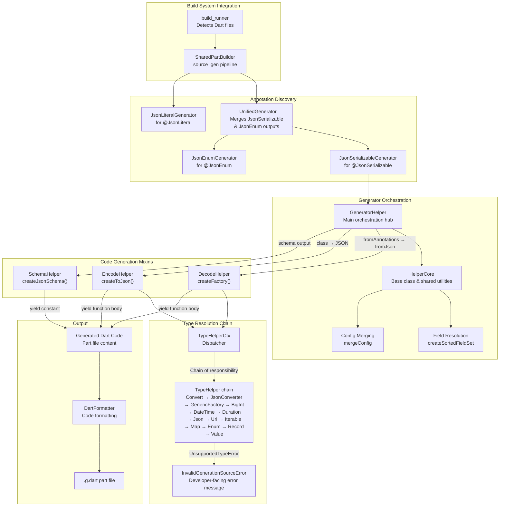
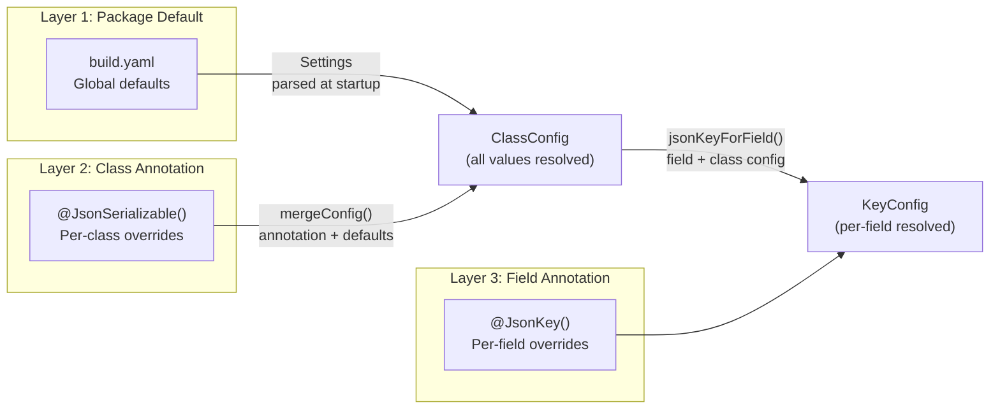
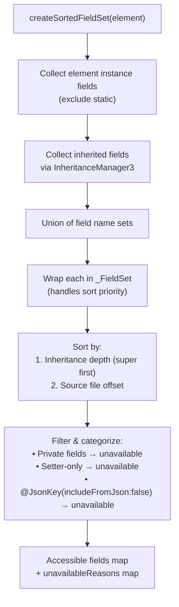
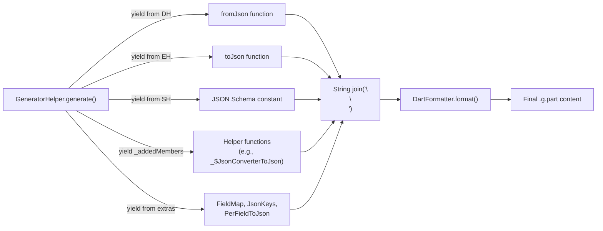
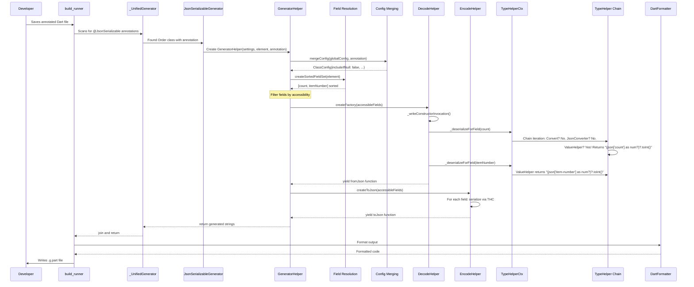

The `json_serializable` generator pipeline transforms Dart class annotations into efficient serialization code through a multi-stage architecture built on `source_gen` and `build_runner`. This page explains how annotations flow through the system to produce the `fromJson`/`toJson` methods you see in generated `.g.dart` files.

## Architecture Overview

The pipeline follows a modular design where each stage has a single responsibility, connected through well-defined interfaces.



Sources: [json_part_builder.dart](json_serializable/lib/src/json_part_builder.dart#L1-L115), [json_serializable_generator.dart](json_serializable/lib/src/json_serializable_generator.dart#L1-L73), [generator_helper.dart](json_serializable/lib/src/generator_helper.dart#L1-L151)

## Stage 1: Build System Registration

The pipeline begins with the build system. The `json_serializable` builder is registered as a `SharedPartBuilder` — a `source_gen` builder type that generates `.g.part` files. These part files are later combined by `source_gen`'s `combining_builder` into the final `.g.dart` file.

The `build.yaml` configuration defines the builder entry point and its file targeting:

| Configuration Key | Value | Purpose |
|---|---|---|
| `import` | `package:json_serializable/builder.dart` | Entry point module |
| `builder_factories` | `["jsonSerializable"]` | Factory function name |
| `build_extensions` | `{".dart": ["json_serializable.g.part"]}` | Output extension mapping |
| `auto_apply` | `dependents` | Automatically apply to all dependent packages |
| `build_to` | `cache` | Output goes to build cache (not source) |
| `applies_builders` | `["source_gen\|combining_builder"]` | Post-processing step |

The `jsonSerializable` function in `builder.dart` reads the `build.yaml` configuration, parses it into a `JsonSerializable` annotation object, and passes it to `jsonPartBuilder`:

```dart
Builder jsonSerializable(BuilderOptions options) {
  var configJson = options.config;
  if (configJson.containsKey('run_only_if_triggered')) {
    configJson = Map.of(configJson)..remove('run_only_if_triggered');
  }
  final config = JsonSerializable.fromJson(configJson);
  return jsonPartBuilder(config: config);
}
```

Sources: [builder.dart](json_serializable/lib/builder.dart#L25-L50), [build.yaml](json_serializable/build.yaml#L1-L131)

## Stage 2: Generator Registration and Unification

The `jsonPartBuilder` function constructs a `SharedPartBuilder` with two generators wrapped in a custom `_UnifiedGenerator`. This wrapper merges outputs from `JsonSerializableGenerator` and `JsonEnumGenerator` so that duplicate enum helper functions are avoided when a class and its enum fields are processed together.

```dart
Builder jsonPartBuilder({...}) {
  final settings = Settings(config: config);
  return SharedPartBuilder(
    [
      _UnifiedGenerator([
        JsonSerializableGenerator.fromSettings(settings),
        const JsonEnumGenerator(),
      ]),
      const JsonLiteralGenerator(),
    ],
    'json_serializable',
    formatOutput: formatOutput ?? defaultFormatOutput,
  );
}
```

The `_UnifiedGenerator` iterates over all annotated elements for each generator, collecting their outputs into a single set (which deduplicates identical strings) and joining them with double newlines.

Sources: [json_part_builder.dart](json_serializable/lib/src/json_part_builder.dart#L16-L115)

## Stage 3: Annotation-to-Configuration Mapping

Before code generation begins, annotations are converted into typed configuration objects. This is a critical transformation step that merges three levels of configuration.

### The Three-Layer Configuration Model



| Configuration Object | Scope | Source | Resolved At |
|---|---|---|---|
| `Settings` | Package-wide | `build.yaml` → `JsonSerializable` | Builder creation |
| `ClassConfig` | Per-class | `Settings.config` + `@JsonSerializable` annotation | `GeneratorHelper` construction |
| `KeyConfig` | Per-field | `@JsonKey` annotation + `ClassConfig` | Each field processing |

The `mergeConfig` function in `utils.dart` implements the resolution logic. It creates a new `ClassConfig` where each field takes the annotation value if non-null, otherwise falls back to the package-level setting. A special case exists for `genericArgumentFactories`: it is set to `true` when the package default is `true` **and** the class has type parameters, preventing spurious warnings.

Sources: [settings.dart](json_serializable/lib/src/settings.dart#L1-L75), [config_types.dart](json_serializable/lib/src/type_helpers/config_types.dart#L1-L192), [utils.dart](json_serializable/lib/src/utils.dart#L108-L172)

## Stage 4: Field Resolution and Ordering

The `createSortedFieldSet` function determines which fields participate in serialization and in what order. This is one of the most nuanced parts of the pipeline because it must handle inheritance hierarchies, private fields, and setter-only properties.

### Field Resolution Algorithm



The sort comparator in `_FieldSet._sortByLocation` first checks whether fields come from different classes in the inheritance chain. If so, the class that is "more super" (i.e., assignable from the other) sorts first. Otherwise, fields are sorted by their source file offset, with getter declarations preferred over setter declarations.

This ordering directly affects the generated code because constructor parameters must be emitted in order.

Sources: [field_helpers.dart](json_serializable/lib/src/field_helpers.dart#L1-L111)

## Stage 5: fromJson Generation (DecodeHelper)

The `DecodeHelper.createFactory` method generates the `_$ClassNameFromJson` function. This is the most complex code generation stage because it must handle multiple strategies depending on configuration.

### Two Generation Strategies

| Strategy | When Used | Generated Pattern |
|---|---|---|
| **Direct construction** | `config.checked == false` (default) | `ClassName(param1, param2, ...)` then cascade `..field = value` |
| **Checked construction** | `config.checked == true` | `$checkedCreate(className, json, ($checkedConvert) { ... })` |

For the direct strategy, the generated code looks like:

```dart
// Generated from example.dart Person class
Person _$PersonFromJson(Map<String, dynamic> json) => Person(
  json['firstName'] as String,
  json['lastName'] as String,
  DateTime.parse(json['date-of-birth'] as String),
  middleName: json['middleName'] as String?,
  lastOrder: json['last-order'] == null
      ? null
      : DateTime.parse(json['last-order'] as String),
  orders: (json['orders'] as List<dynamic>?)
      ?.map((e) => Order.fromJson(e as Map<String, dynamic>))
      .toList(),
);
```

For the checked strategy, wrapped validation with `$checkedConvert` provides detailed error messages when deserialization fails. A `fieldKeyMap` parameter maps Dart field names to their JSON keys for error reporting.

### Key Validation Layer

Before the factory body is generated, `_checkKeys` emits validation calls based on `KeyConfig`:

| Validation | Condition | Emitted Code |
|---|---|---|
| `allowedKeys` | `config.disallowUnrecognizedKeys == true` | `$checkKeys(json, allowedKeys: [...])` |
| `requiredKeys` | Any field with `@JsonKey(required: true)` | Adds `requiredKeys: [...]` |
| `disallowNullValues` | Any field with `@JsonKey(disallowNullValue: true)` | Adds `disallowNullValues: [...]` |

### Field Deserialization Dispatch

Each field is deserialized through `_deserializeForField`, which delegates to the `TypeHelperCtx.deserialize` method. The context first checks for custom `fromJson` functions (via `@JsonKey(fromJson: ...)`), then falls through the `TypeHelper` chain until a helper claims the type.

Sources: [decode_helper.dart](json_serializable/lib/src/decode_helper.dart#L1-L374)

## Stage 6: toJson Generation (EncodeHelper)

The `EncodeHelper.createToJson` method generates the `_$ClassNameToJson` function. Unlike `fromJson`, this always produces a map literal — there are no "checked" or "unchecked" variants.

```dart
// Generated from example.dart Person class
Map<String, dynamic> _$PersonToJson(Person instance) => <String, dynamic>{
  'firstName': instance.firstName,
  'middleName': ?instance.middleName,
  'lastName': instance.lastName,
  'date-of-birth': instance.dateOfBirth.toIso8601String(),
  'last-order': instance.lastOrder?.toIso8601String(),
  'orders': instance.orders,
};
```

### Null-Check Optimization

The `?` prefix before a field access (e.g., `?instance.middleName`) is a null-aware element operator that includes the entry in the map only if the value is non-null. The `_canWriteJsonWithoutNullCheck` method determines whether this optimization applies by checking:

| Condition | Can Skip Null Check? |
|---|---|
| `@JsonKey(includeIfNull: true)` | Yes — always include |
| Converter returns non-nullable type | Yes |
| Nullable converter with non-nullable field type | No — need to check converter output |
| Enum with `null` in encode map | No |
| Field type is non-nullable | Yes |

### Additional Generated Members

Depending on `ClassConfig` options, additional outputs are produced alongside `fromJson`/`toJson`:

| Output | Trigger | Description |
|---|---|---|
| `_$ClassNameFieldMap` | `createFieldMap: true` | `Map<String, String>` of Dart name → JSON key |
| `_$ClassNameJsonKeys` | `createJsonKeys: true` | Abstract class with `static const` fields |
| `_$ClassNamePerFieldToJson` | `createPerFieldToJson: true` | Abstract class with per-field serialization functions |
| `_$ClassNameJsonSchema` | `createJsonSchema: true` | JSON Schema constant |
| `_$jsonLiteral` | `@JsonLiteral` annotation | Dart literal from JSON file |

Sources: [encoder_helper.dart](json_serializable/lib/src/encoder_helper.dart#L1-L185), [schema_helper.dart](json_serializable/lib/src/schema_helper.dart#L1-L100)

## Stage 7: Type Resolution (TypeHelper Chain)

The `TypeHelperCtx` is the dispatcher that routes type serialization and deserialization to the correct `TypeHelper`. It implements the **Chain of Responsibility** pattern — iterating through all registered helpers until one returns a non-null result.

### TypeHelper Resolution Order

The resolution order is determined by `Settings.allHelpers`, which constructs the chain in a specific priority:

```mermaid
flowchart LR
    subgraph "Priority 1: Custom Converters"
        CH["ConvertHelper<br/>@JsonKey(fromJson/toJson)"]
        JCH["JsonConverterHelper<br/>@JsonConverter()"]
        GFH["GenericFactoryHelper<br/>genericArgumentFactories"]
    end

    subgraph "Priority 2: Registered Helpers"
        BIH["BigIntHelper"]
        DTH["DateTimeHelper"]
        DUH["DurationHelper"]
        JH["JsonHelper"]
        UH["UriHelper"]
    end

    subgraph "Priority 3: Core Helpers"
        IH["IterableHelper"]
        MH["MapHelper"]
        EH["EnumHelper"]
        RH["RecordHelper"]
        VH["ValueHelper<br/>String/int/double/bool/null"]
    end

    CH --> JCH --> GFH --> BIH --> DTH --> DUH --> JH --> UH --> IH --> MH --> EH --> RH --> VH
```



| Helper | Handles | Serialize Pattern | Deserialize Pattern |
|---|---|---|---|
| `ConvertHelper` | `@JsonKey(fromJson/toJson)` | `toJsonFn(expression)` | `fromJsonFn(expression)` |
| `JsonConverterHelper` | `@JsonConverter()` classes | `converter.toJson(expression)` | `converter.fromJson(expression)` |
| `GenericFactoryHelper` | Generic type parameters | `toJsonT(expression)` | `fromJsonT(expression)` |
| `BigIntHelper` | `BigInt` | `BigInt.parse(expression)` | `expression.toString()` |
| `DateTimeHelper` | `DateTime` | `expression.toIso8601String()` | `DateTime.parse(expression)` |
| `DurationHelper` | `Duration` | `expression.inMicroseconds` | `Duration(microseconds: expression)` |
| `UriHelper` | `Uri` | `expression.toString()` | `Uri.parse(expression)` |
| `IterableHelper` | `List<T>`, `Set<T>` | `.map(...).toList()` / `.toSet()` | `.cast<Map>()` with recursive |
| `MapHelper` | `Map<K,V>` | Direct with recursive | Direct with recursive |
| `EnumHelper` | Enum types | `.index` or custom | Enum values lookup |
| `RecordHelper` | Record types | Field-by-field | Field-by-field with casts |
| `ValueHelper` | Primitives | Direct (identity) | `as Type` cast |

### Nullable Handling

When a type is nullable and the converter/serializer expects non-nullable input, the `TypeHelperCtx` generates wrapper functions like `_$JsonConverterToJson` and `_$JsonConverterFromJson` that add null guards. These are emitted as top-level members via `addMember`.

Sources: [type_helper_ctx.dart](json_serializable/lib/src/type_helper_ctx.dart#L1-L184), [settings.dart](json_serializable/lib/src/settings.dart#L36-L56), [type_helper.dart](json_serializable/lib/src/type_helper.dart#L1-L87)

## Stage 8: Error Reporting

When type resolution fails (no `TypeHelper` claims the type), the pipeline throws an `InvalidGenerationSourceError` with actionable guidance. The `createInvalidGenerationError` function in `helper_core.dart` constructs messages that vary by failure mode:

| Failure Mode | Message Pattern |
|---|---|
| `TypeParameterType` without `genericArgumentFactories` | Suggests `@JsonConverter`, `@JsonKey(fromJson)`, or `genericArgumentFactories: true` |
| Known type name (e.g., custom class) | Suggests `@JsonConverter` or `@JsonKey(fromJson/toJson)` |
| Unknown type | Generic guidance with converter instructions |

This error reporting is a key part of the developer experience — the generator attempts to predict *why* it couldn't generate code and suggests specific fixes.

Sources: [helper_core.dart](json_serializable/lib/src/helper_core.dart#L46-L94)

## Stage 9: Output Assembly and Formatting

The final stage assembles all generated members into a single string, which is then formatted using `dart_style`'s `DartFormatter`.



The `defaultFormatOutput` function applies Dart formatting using the project's language version constraint:

```dart
String defaultFormatOutput(String code, Version languageVersion) =>
    DartFormatter(languageVersion: languageVersion).format(code);
```

Sources: [json_part_builder.dart](json_serializable/lib/src/json_part_builder.dart#L109-L115)

## Complete Pipeline Data Flow

To illustrate the full pipeline end-to-end, consider this annotated class and its journey through the system:

```dart
@JsonSerializable(includeIfNull: false)
class Order {
  int? count;
  @JsonKey(name: 'item-number')
  int? itemNumber;
  
  Order();

  factory Order.fromJson(Map<String, dynamic> json) => _$OrderFromJson(json);
  Map<String, dynamic> toJson() => _$OrderToJson(this);
}
```



Sources: [generator_helper.dart](json_serializable/lib/src/generator_helper.dart#L44-L151), [decode_helper.dart](json_serializable/lib/src/decode_helper.dart#L26-L197), [encoder_helper.dart](json_serializable/lib/src/encoder_helper.dart#L105-L148), [type_helper_ctx.dart](json_serializable/lib/src/type_helper_ctx.dart#L54-L72)

## Next Steps

After understanding the generator pipeline, you may want to explore specific components in greater detail:

- **Deep dive into type conversion**: [The TypeHelper Extension System](9-the-typehelper-extension-system) covers the extensibility mechanism for adding new type support.
- **Understanding fromJson/toJson internals**: [DecodeHelper and EncodeHelper: fromJson/toJson Generation](10-decodehelper-and-encodehelper-fromjson-tojson-generation) examines the two main code generation mixins.
- **Orchestration details**: [GeneratorHelper Orchestration and Field Resolution](11-generatorhelper-orchestration-and-field-resolution) covers field filtering, ordering, and the helper lifecycle.
- **Extending the system**: [Writing a Custom TypeHelper](21-writing-a-custom-typehelper) walks through adding support for a new type.