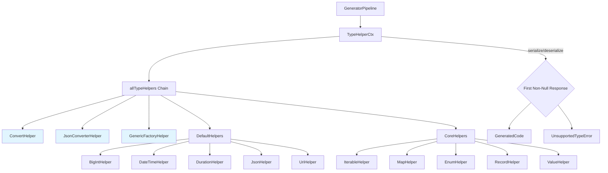
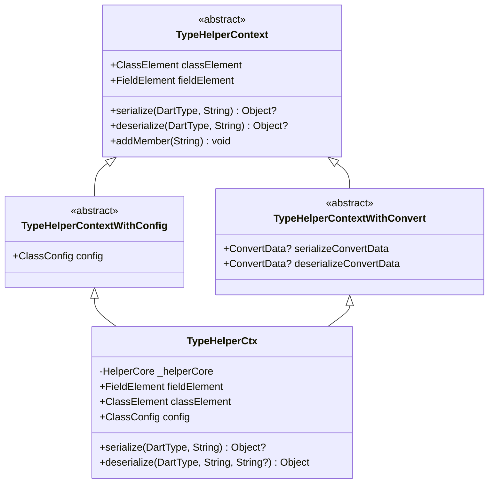
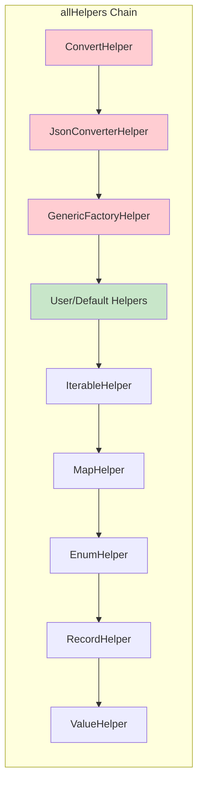
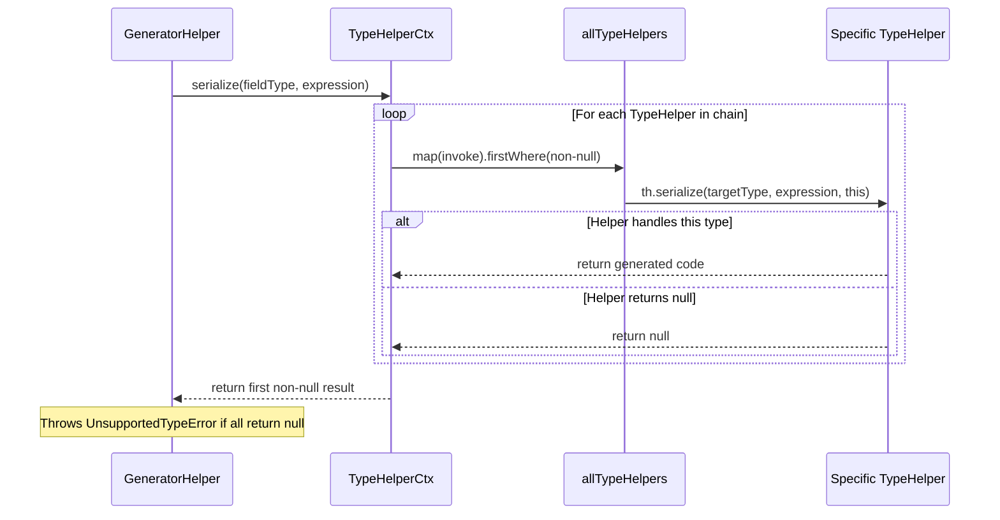

The TypeHelper extension system is the core architectural pattern that enables `json_serializable` to generate serialization and deserialization code for a wide variety of Dart types. This extensible framework allows the generator to handle everything from primitive types like `String` and `int` to complex generic collections and custom domain objects through a chain of responsibility pattern.

## Core Architecture

The TypeHelper system implements a **chain of responsibility** pattern where multiple type-specific handlers are consulted sequentially until one claims responsibility for a given Dart type. This design achieves two critical goals: **separation of concerns** (each type's serialization logic lives in its own class) and **open extensibility** (custom helpers can be added without modifying core code).



Sources: [settings.dart](json_serializable/lib/src/settings.dart#L24-L75), [type_helper_ctx.dart](json_serializable/lib/src/type_helper_ctx.dart#L65-L83)

## The TypeHelper Interface

Every type helper extends the abstract `TypeHelper<T>` class, which defines two fundamental operations: **serialization** (Dart object → JSON representation) and **deserialization** (JSON representation → Dart object). The type parameter `T` specifies the context type available during these operations.

| Method | Purpose | Return Type | Key Behavior |
|--------|---------|-------------|--------------|
| `serialize` | Converts a Dart object to JSON-compatible code | `Object?` | Returns `null` if the helper doesn't handle this type |
| `deserialize` | Converts JSON data to a Dart object | `Object?` | Returns `null` if the helper doesn't handle this type |

The **null-return convention** is the linchpin of the chain: when a helper returns `null`, the system moves to the next helper in the chain. When non-null is returned, that helper has claimed responsibility for the type.

Sources: [type_helper.dart](json_serializable/lib/src/type_helper.dart#L60-L87)

## Context Hierarchy

Type helpers receive context objects that provide access to the current generation state. The context hierarchy has three levels, each adding capabilities:



- **TypeHelperContext**: Base context with class/field information and recursive serialize/deserialize methods
- **TypeHelperContextWithConfig**: Adds access to `ClassConfig` for generator settings
- **TypeHelperContextWithConvert**: Adds `@JsonKey` converter function data for field-specific conversions
- **TypeHelperCtx**: Concrete implementation that composes all three capabilities

Sources: [type_helper.dart](json_serializable/lib/src/type_helper.dart#L10-L58), [type_helper_ctx.dart](json_serializable/lib/src/type_helper_ctx.dart#L12-L62)

## Helper Execution Chain

The execution order of type helpers is deliberately structured with priority tiers. Helpers earlier in the chain get first opportunity to handle a type:

| Priority | Helpers | Purpose | Context Type |
|----------|---------|---------|--------------|
| 1 (Highest) | `ConvertHelper` | Handles `@JsonKey` `toJson`/`fromJson` functions | `TypeHelperContextWithConvert` |
| 2 | `JsonConverterHelper` | Handles `@JsonConverter` annotated types | `TypeHelperContextWithConfig` |
| 3 | `GenericFactoryHelper` | Handles generic type parameters with `genericArgumentFactories` | `TypeHelperContextWithConfig` |
| 4 | Default Helpers | Built-in type-specific helpers (configurable) | Varies |
| 5 (Lowest) | Core Helpers | Collections, enums, values (always present) | `TypeHelperContextWithConfig` |

This ordering ensures that **user-specified customizations take precedence** over built-in handling.

Sources: [settings.dart](json_serializable/lib/src/settings.dart#L14-L47)

## The Type Helper Registry

The `Settings` class maintains two distinct collections of type helpers, each with different characteristics:

**Core Helpers** (always present, not configurable):
```dart
static const _coreHelpers = <TypeHelper>[
  IterableHelper(),
  MapHelper(),
  EnumHelper(),
  RecordHelper(),
  ValueHelper(),
];
```

**Default Helpers** (configurable, can be replaced):
```dart
static const defaultHelpers = <TypeHelper>[
  BigIntHelper(),
  DateTimeHelper(),
  DurationHelper(),
  JsonHelper(),
  UriHelper(),
];
```

The `allHelpers` getter combines these with the fixed-priority helpers:



Sources: [settings.dart](json_serializable/lib/src/settings.dart#L24-L75)

## Return Value Patterns

Type helpers can return several distinct types from their methods, each with different semantics:

| Return Type | Meaning | Example |
|-------------|---------|---------|
| `null` | "I don't handle this type" — chain continues | Most helpers return `null` for unrecognized types |
| `String` | Direct code expression to use | `ValueHelper` returns field access expressions |
| `LambdaResult` | A function reference with implicit argument | Used when calling `fromJson`/`toJson` methods |
| `DefaultContainer` | Expression with null/default value handling | Used for types needing default value support |

The `LambdaResult` class is particularly important — it enables the generator to produce lint-compliant code by preferring function tear-offs over lambda wrappers:

```dart
// LambdaResult enables this optimization:
// Instead of: (value) => MyClass.fromJson(value)
// Generates:  MyClass.fromJson  (when closureArg matches)
```

Sources: [lambda_result.dart](json_serializable/lib/src/lambda_result.dart#L15-L45), [default_container.dart](json_serializable/lib/src/default_container.dart#L12-L45)

## Built-in Helper Implementation Patterns

Each built-in helper follows one of several established patterns:

### Pattern 1: Simple Type Passthrough (`ValueHelper`)
For types that are already JSON-compatible, the helper simply returns the expression unchanged:

```dart
// ValueHelper handles: String, bool, num, int, double
String? serialize(DartType targetType, String expression, ...) {
  if (simpleJsonTypeChecker.isAssignableFromType(targetType)) {
    return expression;  // No transformation needed
  }
  return null;
}
```

Sources: [value_helper.dart](json_serializable/lib/src/type_helpers/value_helper.dart#L14-L32)

### Pattern 2: String Conversion (`ToFromStringHelper`)
For types with parse/toString methods, a reusable helper pattern:

| Type | Parse Method | ToString Method |
|------|-------------|-----------------|
| `BigInt` | `BigInt.parse()` | `.toString()` |
| `DateTime` | `DateTime.parse()` | `.toIso8601String()` |
| `Uri` | `Uri.parse()` | `.toString()` |

Sources: [to_from_string.dart](json_serializable/lib/src/type_helpers/to_from_string.dart#L10-L47), [big_int_helper.dart](json_serializable/lib/src/type_helpers/big_int_helper.dart#L12-L35)

### Pattern 3: Collection Recursion (`IterableHelper`, `MapHelper`)
Collections recursively call back into the type helper chain for their element types:

```dart
// IterableHelper recursively serializes elements:
final subField = context.serialize(itemType, closureArg)!;
// Then maps over the collection with the element serialization
```

Sources: [iterable_helper.dart](json_serializable/lib/src/type_helpers/iterable_helper.dart#L22-L65)

### Pattern 4: Generated Member Addition (`EnumHelper`, `RecordHelper`)
Helpers that need supplementary code add top-level members:

```dart
context.addMember(memberContent);  // Adds enum value map or helper function
```

Sources: [enum_helper.dart](json_serializable/lib/src/type_helpers/enum_helper.dart#L28-L35), [record_helper.dart](json_serializable/lib/src/type_helpers/record_helper.dart#L40-L45)

## Integration with the Generator Pipeline

The TypeHelper system is invoked through `TypeHelperCtx`, which acts as the bridge between the generator pipeline and the helper chain:



Sources: [type_helper_ctx.dart](json_serializable/lib/src/type_helper_ctx.dart#L65-L83)

## Error Handling

When no type helper claims responsibility for a type, the system throws `UnsupportedTypeError`, which is caught and transformed into a user-friendly `InvalidGenerationSourceError` with actionable guidance:

```dart
// Error message suggests solutions:
// - Use @JsonConverter annotation
// - Use @JsonKey with fromJson/toJson functions
// - Set genericArgumentFactories for generic types
```

Sources: [unsupported_type_error.dart](json_serializable/lib/src/unsupported_type_error.dart#L10-L17), [helper_core.dart](json_serializable/lib/src/helper_core.dart#L52-L98)

## Customization Points

The TypeHelper system offers two primary extension mechanisms:

| Mechanism | Scope | Use Case |
|-----------|-------|----------|
| Custom `TypeHelper` via `Settings` | All fields of all classes | Framework-level type support |
| `@JsonConverter` annotation | Individual fields or classes | Application-specific types |

When building a custom `jsonPartBuilder`, you can inject additional helpers:

```dart
// Custom builder with extended type support
jsonPartBuilder(
  typeHelpers: [
    ...Settings.defaultHelpers,
    MyCustomTypeHelper(),
  ],
);
```

Sources: [settings.dart](json_serializable/lib/src/settings.dart#L56-L75), [json_serializable_generator.dart](json_serializable/lib/src/json_serializable_generator.dart#L39-L48)

## Related Documentation

For practical guidance on extending the system, see:
- [Writing a Custom TypeHelper](21-writing-a-custom-typehelper) — Step-by-step tutorial for creating your own type helper
- [JsonConverter for Custom Type Serialization](7-jsonconverter-for-custom-type-serialization) — The annotation-based approach for custom types
- [Built-in Type Helpers: DateTime, Duration, BigInt, Uri](13-built-in-type-helpers-datetime-duration-bigint-uri) — Detailed implementation of string-conversion helpers
- [Collection Type Helpers: Iterable, Map, Record](14-collection-type-helpers-iterable-map-record) — Recursive type handling patterns